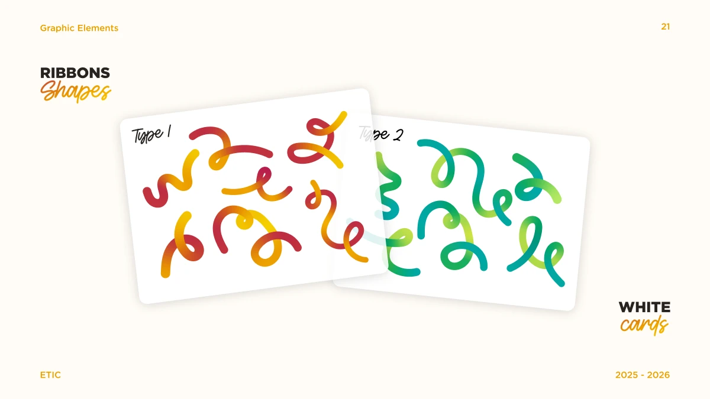
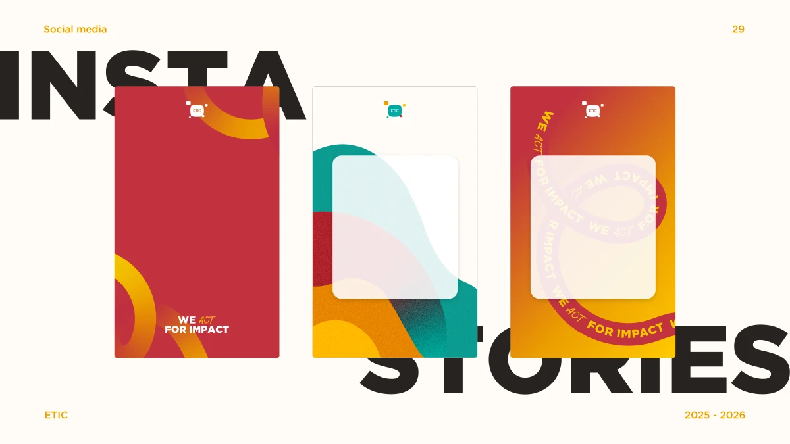

# Comprendre la direction artistique ETIC

Le kit sert à composer une interface ETIC, pas simplement à placer un logo et quelques couleurs sur une interface générique. Cette lecture distingue **les règles écrites de la charte**, **les procédés observés dans ses compositions** et **les choix proposés pour le frontend**.

## Le principe central : structure et mouvement

La charte décrit une identité qui associe professionnalisme, créativité, collaboration et impact. Gotham apporte une structure nette ; Humming apporte une expression plus personnelle. Les formes géométriques évoquent la construction et la diversité, les lignes épaisses introduisent le mouvement, et les dégradés/textures donnent de la profondeur. Sources : [intention, 1:1248](https://www.figma.com/design/eofQFq1bCM8Ooe5KXBDRsk?node-id=1-1248), [Gotham, 1:1816](https://www.figma.com/design/eofQFq1bCM8Ooe5KXBDRsk?node-id=1-1816), [Humming, 1:1888](https://www.figma.com/design/eofQFq1bCM8Ooe5KXBDRsk?node-id=1-1888).

**Lecture artistique :** l’identité repose sur un équilibre entre un cadre sérieux et des éléments libres. Une interface uniquement géométrique et rigide perd l’expression de la charte ; une interface remplie de rubans perd sa structure.

## 1. Une palette organisée, pas un arc-en-ciel permanent

**Règle officielle :** les fonds de composition sont rouge, beige ou dégradés 1, 2, 5. Les neuf couleurs ne sont pas neuf fonds de page interchangeables.

**Observation :** rouge/orange/jaune construisent la famille chaude ; teal/green et les nuances claires des rubans construisent la famille froide. Les compositions peuvent réunir ces familles, mais les exemples ne distribuent pas chaque couleur uniformément sur chaque objet. Une couleur dominante donne une direction ; les autres créent un contraste local. Pour les rubans dans les pages du projet, appliquer la règle plus précise ci-dessous.

**Application frontend :** choisir un fond de marque et une seule famille de rubans colorés pour toute la page. Ne pas changer de famille entre le bandeau, le corps et le pied de page. Réserver la sémantique succès/erreur aux éléments qui communiquent réellement un état. Un ruban vert n’est pas, à lui seul, un message de réussite. Les couleurs internes d’une illustration n’étendent pas la palette officielle de l’UI.

## Une seule famille de rubans par page

La direction du propriétaire est explicite : choisir **warm OU cool pour toute la page**, pas une famille par section. Le trait noir neutre ne constitue pas une deuxième famille colorée. Une page sans ruban est aussi possible. Cette règle concerne les rubans, y compris ceux visibles dans un sticker composé ; elle n’impose pas de recolorer les logos, les états ou toutes les géométries.

La charte présente parfois les deux familles dans une même planche de démonstration. Cette observation ne remplace pas le choix de composition demandé pour les pages de l’application. Les illustrations à rubans mixtes sont indiquées dans le manifeste.

[Parcours général de composition](composition-workflow.md) · [Rubans disponibles](../etic-ui/assets/ribbons/README.md)

## Associations de fond et de ruban : direction précisée par le propriétaire

La correction apportée sur le bandeau « Le plan de classe » précise le choix attendu dans les interfaces du projet. **Un asset officiel ne convient pas automatiquement à tous les fonds officiels.** Vérifier la relation entre le fond dominant et le décor, en plus de la provenance de chacun.

| Composition | Choix attendu | À éviter |
| --- | --- | --- |
| Grand bandeau rouge avec texte blanc | Ruban chaud, avec jaune/orange ou zones claires bien visibles | Gros ruban vert/teal superposé au rouge |
| Ruban vert/teal | Fond beige, ou composition associée au jaune/orange dont les masses sont équilibrées | Le poser sur un hero rouge simplement parce qu’il est disponible dans le catalogue |
| Surface beige avec quelques boutons rouges | Évaluer le décor par rapport au fond beige et à ses voisins immédiats | Interdire automatiquement un ruban froid parce qu’un bouton rouge existe ailleurs sur la page |

**Origine : direction artistique donnée par le propriétaire du projet à partir de son écran réel.** Ce tableau n’est pas une interdiction universelle rouge/vert prétendument écrite dans Figma. Il n’autorise pas non plus un nouveau fond de page jaune uni : conserver les fonds officiels documentés. Les emblèmes multicolores et les stickers finis gardent leurs couleurs d’origine.

Pour corriger ce bandeau, conserver le fond rouge et les textes blancs, puis remplacer le ruban froid par un asset chaud existant. Candidats : `ribbon-warm-loop-01`, `ribbon-warm-loop-02`, `ribbon-warm-oversized`, `wave-light-short`. Vérifier le rendu à la taille réelle : le rouge contenu dans un ruban chaud peut se fondre dans le fond rouge ; placer ses zones jaune/orange visibles là où elles définissent la silhouette. Ne pas appliquer de filtre CSS pour recolorer le ruban vert.

Cette consigne est également inscrite dans `pairingGuidance` du manifeste pour les rubans identifiés, afin qu’un agent qui consulte un fichier individuel la voie.

## 2. La typographie constitue une grande partie de l’identité

La planche de hiérarchie donne les spécimens suivants. Les valeurs décrivent la planche de 1920 px, **pas des tailles obligatoires pour un téléphone**.

| Rôle source | Police | Taille du spécimen | Interligne | Casse |
| --- | --- | ---: | ---: | --- |
| Grand titre 1:1990 | Gotham Black | 110 px | 93 % | capitales |
| Petit titre 1:1991 | Gotham Pro Bold | 64 px | 134 % | casse de titre |
| Sous-titre 1:1992 | Humming Regular | 64 px | 134 % | casse de titre |
| Corps 1:1989 | Gotham Pro Regular | 24 px | 134 % | casse de phrase |

[Planche de hiérarchie](brand/boards/1-1980.webp)

**Observation :** les mots forts sont compacts et lourds ; une courte expression Humming les accompagne. La police expressive sert d’accent, pas de police de tous les boutons, paragraphes et nombres. Le corps reste calme et lisible. La charte dispose aussi de Noto Sans Arabic pour l’arabe.

**Application frontend :** utiliser `BrandHeading` pour un titre expressif, `etic-heading` pour un titre UI plus simple et la police de corps pour les contrôles. La balise h1/h2/h3 suit la structure du document ; elle n’impose pas un niveau de taille. Pour les longs titres ou l’arabe, éviter de reproduire aveuglément l’interligne très serré du spécimen. Sans fichiers de polices autorisés, documenter la différence de rendu ; un fallback ne peut pas rendre la typographie identique.

## 3. Des rubans qui se croisent, pas des courbes ajoutées au hasard

**Observation :** les rubans ont une épaisseur forte, des courbes arrondies et des changements de couleur qui donnent une sensation de volume et de passage dessus/dessous. Les grandes courbes sont souvent coupées par les bords de la composition : elles semblent continuer hors du cadre. Les lignes avec slogans sont des illustrations typographiques fixes. La fine boucle noire de la planche 22 est un autre registre, plus léger.

**Application frontend :** choisir un geste graphique cohérent : boucle, croisement, vague ou ligne fine. Laisser l’asset entier lorsque sa forme est le sujet ; le recadrer uniquement comme décor de bordure lorsque cela sert la composition. Ne pas déformer le ratio pour remplir un espace. Ne pas couper une partie d’un slogan nécessaire à sa compréhension. Le logo, lui, ne doit jamais être recadré.

## 4. Une profondeur de matière

**Observation :** les formes libres emploient du grain, des superpositions et des dégradés. Les cartes blanches paraissent posées au-dessus grâce à leurs ombres et parfois une rotation légère. Cela évoque une composition imprimée, des cartes ou des stickers, plutôt qu’une accumulation d’effets lumineux.

**Application frontend :** conserver la texture dans les assets qui la possèdent. Ne pas ajouter du bruit à tous les boutons. Les ombres des cartes sont autorisées par les exemples ; les ombres sur le logo sont interdites. Les cartes de contenu interactif restent droites et adaptables. La transparence de 88 % n’est pas un effet de flou : les composants n’ajoutent pas de `backdrop-filter` absent de la source.

## 5. Une hiérarchie spatiale : décor, carte, contenu

Les planches et stories montrent trois couches lisibles : un fond, une composition graphique, puis une surface réservée au contenu. L’asymétrie des décors coexiste avec un alignement clair des textes et des actions.

**Application frontend :** les membres peuvent varier le décor tout en gardant la même typographie UI, les mêmes boutons et les mêmes espacements. Laisser une marge réelle entre l’artwork et les commandes. Sur mobile, réduire ou déplacer le décor avant de réduire le texte ou les zones tactiles.

## Recettes proposées pour les interfaces

Ces recettes sont une traduction pour le produit, pas de nouvelles prescriptions officielles.

| Situation | Composition conseillée | Ressources |
| --- | --- | --- |
| Instructions ou formulaire | Fond beige, carte `paper` ou `wide-soft`, texte ink, action rouge ; une boucle dans une marge séparée | `ribbon-cool-loop-01`, `loop-thin-ink` |
| Introduction d’une activité | Fond rouge, emblème blanc avec 2x, titre blanc, grand ruban chaud dans une zone dédiée | `ribbon-story-warm`, `ribbon-warm-oversized` |
| Zone de jeu ou canvas | Surface calme et contrôles communs ; art limité au cadre extérieur | tokens UI et composants, sans texture sur les contrôles |
| Résultat ou célébration | Message textuel clair, un sticker fixe, actions de suite groupées | `stickers-03`, `stickers-09` |
| Carte éditoriale compacte | `story` ou `caption`, accent Humming court, contenu de corps structuré | `BrandHeading`, `BrandCard` |

## Avant de livrer une interface

1. Quelle famille visuelle domine, et le couple fond/ruban respecte-t-il les associations ci-dessus ?
2. La hiérarchie du titre et du corps reste-t-elle claire sans décor ?
3. Le ruban, motif ou sticker est-il choisi dans le catalogue pour son rôle précis ?
4. Le logo garde-t-il ses couleurs, proportions et sa zone 2x ?
5. La composition laisse-t-elle lire et agir au clavier et sur mobile ?
6. Les écarts nécessaires au web sont-ils présentés comme des adaptations, pas des règles officielles ?

Une identité commune ne signifie pas que toutes les interfaces doivent être identiques. Elle signifie que leurs différences restent organisées par les mêmes choix de typographie, de couleur, de forme et de hiérarchie.
