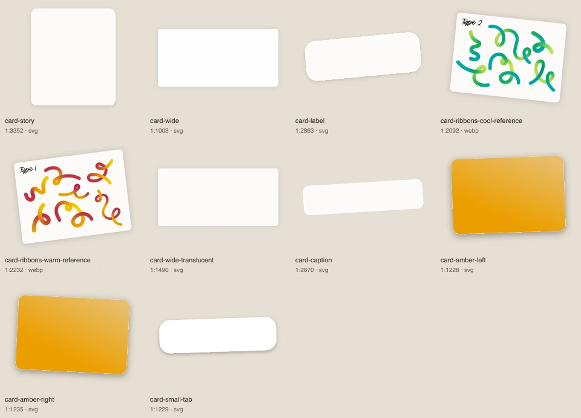
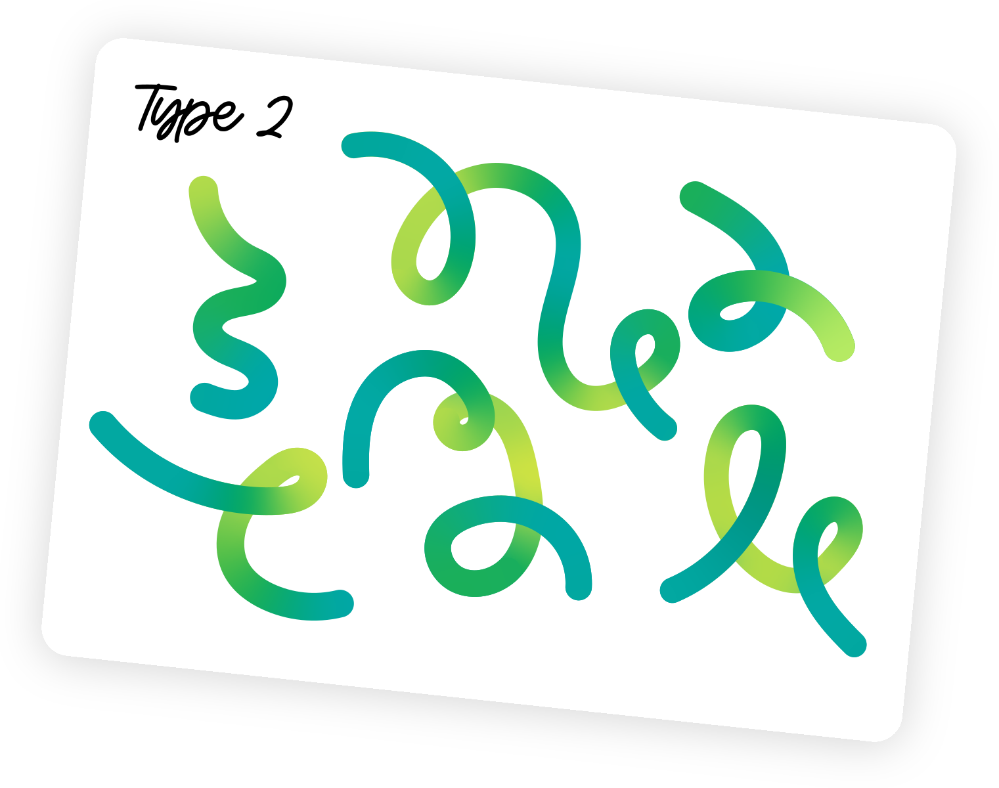
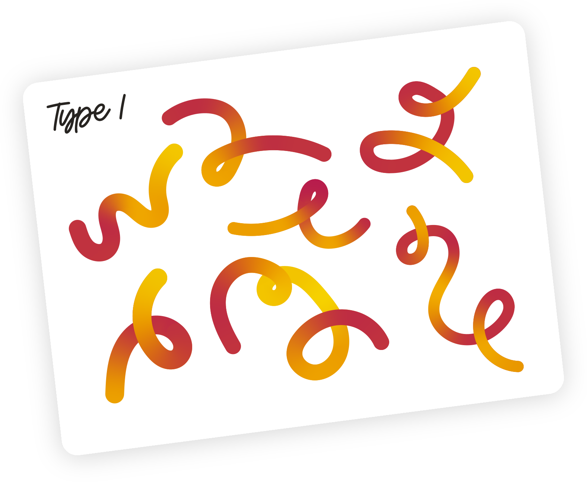

# Cartes

[Retour au catalogue](../assets.md)

## card-story

Fond de carte sans texte. Préférer BrandCard pour un contenu interactif.

- Fichier : [cards/card-story.svg](../../etic-ui/assets/cards/card-story.svg)
- Format : SVG, 344 × 392 px, 1.0 Ko
- [Source Figma 1:3352](https://www.figma.com/design/eofQFq1bCM8Ooe5KXBDRsk?node-id=1-3352)

## card-wide

Fond de carte sans texte. Préférer BrandCard pour un contenu interactif.

- Fichier : [cards/card-wide.svg](../../etic-ui/assets/cards/card-wide.svg)
- Format : SVG, 1568 × 792 px, 0.8 Ko
- [Source Figma 1:1003](https://www.figma.com/design/eofQFq1bCM8Ooe5KXBDRsk?node-id=1-1003)

## card-label

Fond de carte sans texte. Préférer BrandCard pour un contenu interactif.

- Fichier : [cards/card-label.svg](../../etic-ui/assets/cards/card-label.svg)
- Format : SVG, 439 × 204 px, 1.1 Ko
- [Source Figma 1:2863](https://www.figma.com/design/eofQFq1bCM8Ooe5KXBDRsk?node-id=1-2863)

## card-ribbons-cool-reference

Carte composée avec ses rubans et son titre, référence visuelle ; ne pas l’utiliser comme interface interactive.

- Fichier : [cards/card-ribbons-cool-reference.webp](../../etic-ui/assets/cards/card-ribbons-cool-reference.webp)
- Format : WEBP, 1521 × 1200 px, 139.8 Ko
- [Source Figma 1:2092](https://www.figma.com/design/eofQFq1bCM8Ooe5KXBDRsk?node-id=1-2092)

## card-ribbons-warm-reference

Carte composée avec ses rubans et son titre, référence visuelle ; ne pas l’utiliser comme interface interactive.

- Fichier : [cards/card-ribbons-warm-reference.webp](../../etic-ui/assets/cards/card-ribbons-warm-reference.webp)
- Format : WEBP, 1576 × 1296 px, 137.3 Ko
- [Source Figma 1:2232](https://www.figma.com/design/eofQFq1bCM8Ooe5KXBDRsk?node-id=1-2232)

## card-wide-translucent

Fond de carte sans texte. Préférer BrandCard pour un contenu interactif.

- Fichier : [cards/card-wide-translucent.svg](../../etic-ui/assets/cards/card-wide-translucent.svg)
- Format : SVG, 1568 × 792 px, 0.8 Ko
- [Source Figma 1:1490](https://www.figma.com/design/eofQFq1bCM8Ooe5KXBDRsk?node-id=1-1490)

## card-caption

Fond de carte sans texte. Préférer BrandCard pour un contenu interactif.

- Fichier : [cards/card-caption.svg](../../etic-ui/assets/cards/card-caption.svg)
- Format : SVG, 448 × 144 px, 0.2 Ko
- [Source Figma 1:2670](https://www.figma.com/design/eofQFq1bCM8Ooe5KXBDRsk?node-id=1-2670)

## card-amber-left

Fond de carte sans texte. Préférer BrandCard pour un contenu interactif.

- Fichier : [cards/card-amber-left.svg](../../etic-ui/assets/cards/card-amber-left.svg)
- Format : SVG, 824 × 592 px, 1.2 Ko
- [Source Figma 1:1228](https://www.figma.com/design/eofQFq1bCM8Ooe5KXBDRsk?node-id=1-1228)

## card-amber-right

Fond de carte sans texte. Préférer BrandCard pour un contenu interactif.

- Fichier : [cards/card-amber-right.svg](../../etic-ui/assets/cards/card-amber-right.svg)
- Format : SVG, 832 × 600 px, 1.1 Ko
- [Source Figma 1:1235](https://www.figma.com/design/eofQFq1bCM8Ooe5KXBDRsk?node-id=1-1235)

## card-small-tab

Fond de carte sans texte. Préférer BrandCard pour un contenu interactif.

- Fichier : [cards/card-small-tab.svg](../../etic-ui/assets/cards/card-small-tab.svg)
- Format : SVG, 336 × 124 px, 1.0 Ko
- [Source Figma 1:1229](https://www.figma.com/design/eofQFq1bCM8Ooe5KXBDRsk?node-id=1-1229)
