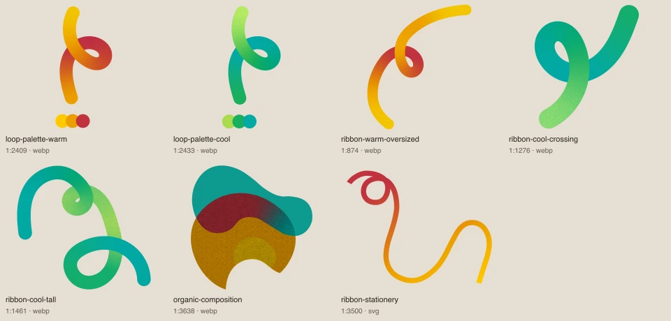
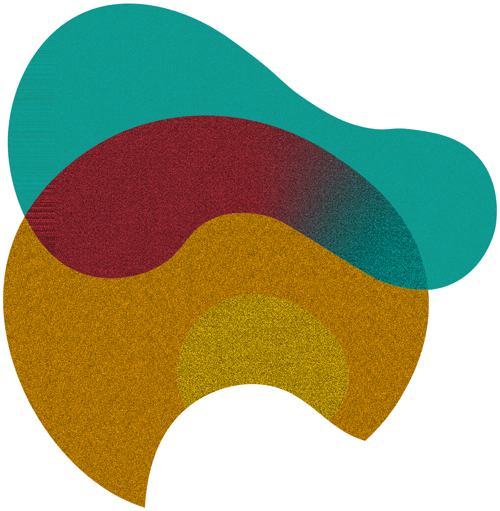
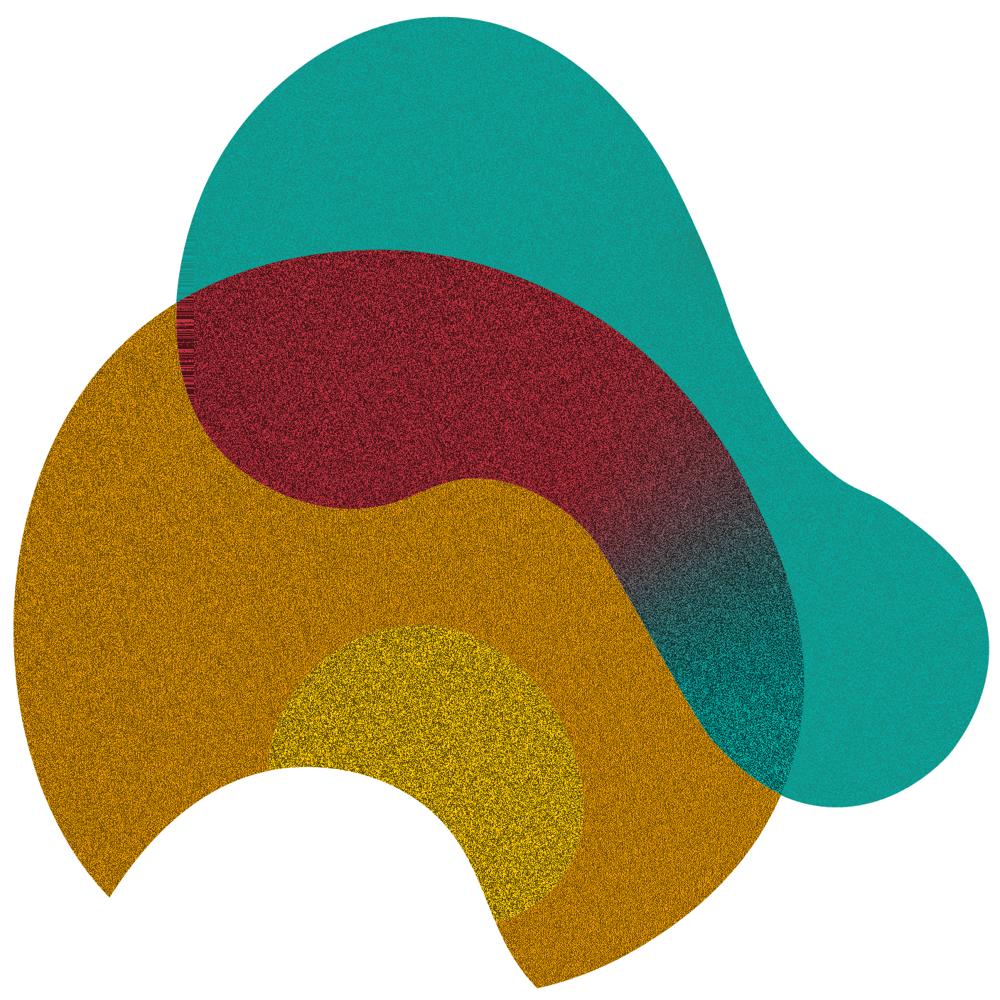

# Compositions

[Retour au catalogue](../assets.md)

## organic-composition

Composition existante. Conserver le rapport entre ses éléments.

- Fichier : [compositions/organic-composition.webp](../../etic-ui/assets/compositions/organic-composition.webp)
- Format : WEBP, 1567 × 1600 px, 525.4 Ko
- [Source Figma 1:3638](https://www.figma.com/design/eofQFq1bCM8Ooe5KXBDRsk?node-id=1-3638)

## shapes-stack

Composition existante. Conserver le rapport entre ses éléments.

- Fichier : [decorations/shapes-stack.svg](../../etic-ui/assets/decorations/shapes-stack.svg)
- Format : SVG, 457 × 715 px, 1.1 Ko
- [Source Figma 1:2399](https://www.figma.com/design/eofQFq1bCM8Ooe5KXBDRsk?node-id=1-2399)

## organic-story-collage

Élément isolé de la composition source. Conserver ses proportions et réserver une zone décorative.

- Fichier : [compositions/organic-story-collage.webp](../../etic-ui/assets/compositions/organic-story-collage.webp)
- Format : WEBP, 1407 × 1407 px, 396.1 Ko
- [Source Figma 1:3326](https://www.figma.com/design/eofQFq1bCM8Ooe5KXBDRsk?node-id=1-3326)
