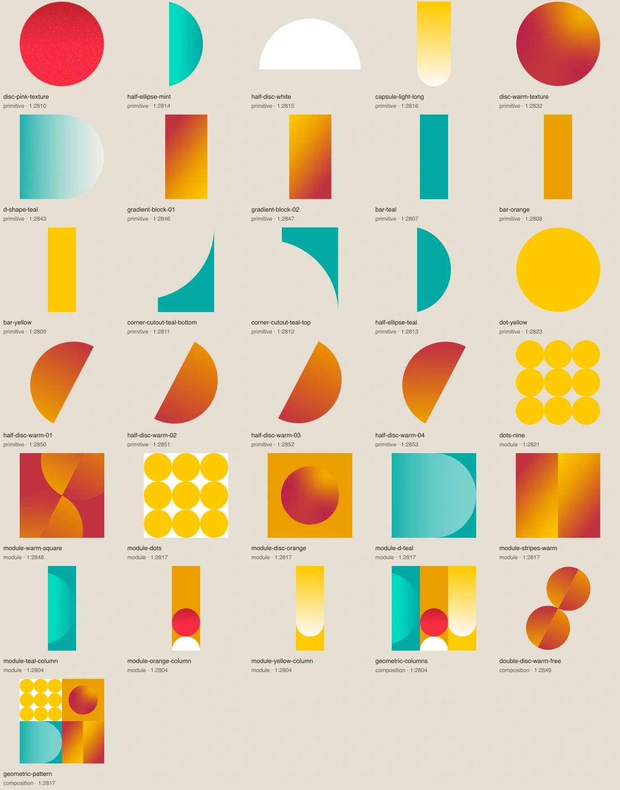
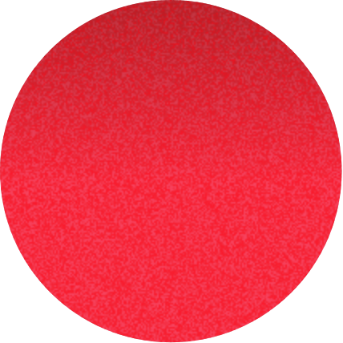
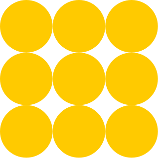
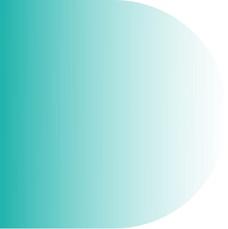
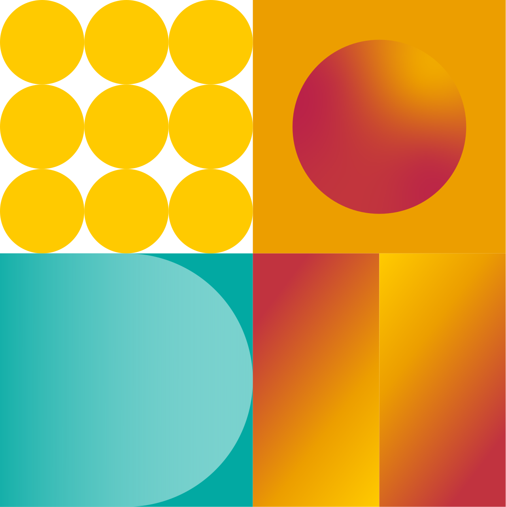
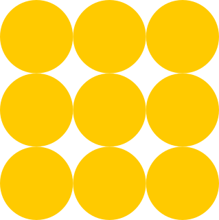
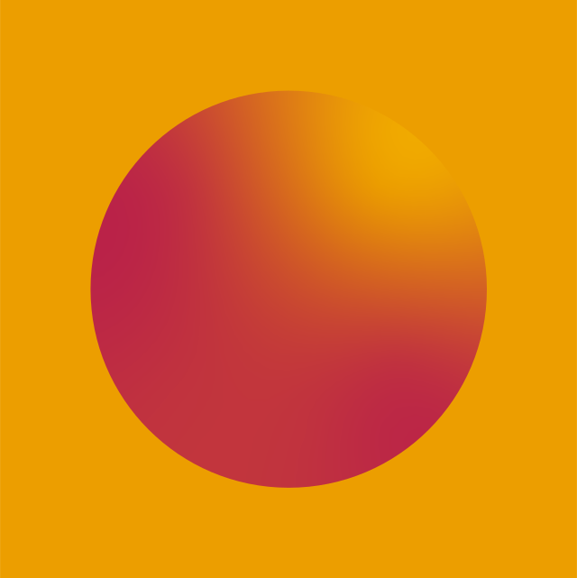
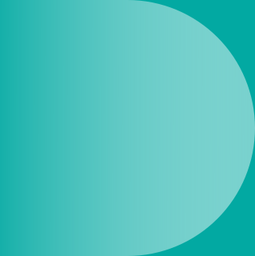
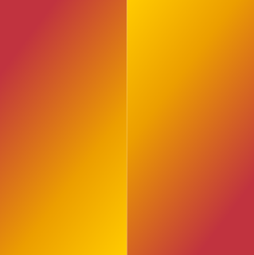
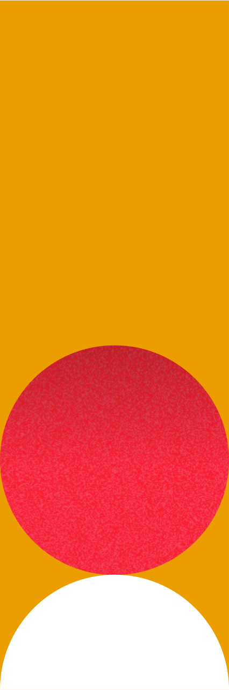

# Formes géométriques

[Retour au catalogue](../assets.md)

## geometric-columns

Composition complète. Les éléments qui la constituent sont également disponibles comme primitives ou modules.

- Niveau : **composition**

- Fichier : [geometric/compositions/geometric-columns.webp](../../etic-ui/assets/geometric/compositions/geometric-columns.webp)
- Format : WEBP, 1280 × 1282 px, 177.9 Ko
- [Source Figma 1:2804](https://www.figma.com/design/eofQFq1bCM8Ooe5KXBDRsk?node-id=1-2804)

## disc-pink-texture

Primitive isolée. Son contour est conservé ; elle ne constitue pas à elle seule une composition complète.

- Niveau : **primitive**

- Fichier : [geometric/primitives/disc-pink-texture.webp](../../etic-ui/assets/geometric/primitives/disc-pink-texture.webp)
- Format : WEBP, 428 × 428 px, 163.5 Ko
- [Source Figma 1:2810](https://www.figma.com/design/eofQFq1bCM8Ooe5KXBDRsk?node-id=1-2810)

## half-ellipse-mint

Primitive isolée. Son contour est conservé ; elle ne constitue pas à elle seule une composition complète.

- Niveau : **primitive**

- Anciens noms d’import conservés : `semicircle-mint`

- Fichier : [geometric/primitives/half-ellipse-mint.svg](../../etic-ui/assets/geometric/primitives/half-ellipse-mint.svg)
- Format : SVG, 213 × 532 px, 0.5 Ko
- [Source Figma 1:2814](https://www.figma.com/design/eofQFq1bCM8Ooe5KXBDRsk?node-id=1-2814)

## half-disc-white

Primitive isolée. Son contour est conservé ; elle ne constitue pas à elle seule une composition complète.

- Niveau : **primitive**

- Anciens noms d’import conservés : `semicircle-white`

- Fichier : [geometric/primitives/half-disc-white.svg](../../etic-ui/assets/geometric/primitives/half-disc-white.svg)
- Format : SVG, 213 × 107 px, 0.3 Ko
- [Source Figma 1:2815](https://www.figma.com/design/eofQFq1bCM8Ooe5KXBDRsk?node-id=1-2815)

## capsule-light-long

Primitive isolée. Son contour est conservé ; elle ne constitue pas à elle seule une composition complète.

- Niveau : **primitive**

- Fichier : [geometric/primitives/capsule-light-long.svg](../../etic-ui/assets/geometric/primitives/capsule-light-long.svg)
- Format : SVG, 213 × 534 px, 0.8 Ko
- [Source Figma 1:2816](https://www.figma.com/design/eofQFq1bCM8Ooe5KXBDRsk?node-id=1-2816)

## dots-nine

Module composé et recadré selon la planche source. Conserver le cadrage, les proportions et les rapports entre ses parties.

- Niveau : **module**

- Fichier : [geometric/modules/dots-nine.svg](../../etic-ui/assets/geometric/modules/dots-nine.svg)
- Format : SVG, 320 × 321 px, 1.9 Ko
- [Source Figma 1:2821](https://www.figma.com/design/eofQFq1bCM8Ooe5KXBDRsk?node-id=1-2821)

## disc-warm-texture

Primitive isolée. Son contour est conservé ; elle ne constitue pas à elle seule une composition complète.

- Niveau : **primitive**

- Fichier : [geometric/primitives/disc-warm-texture.webp](../../etic-ui/assets/geometric/primitives/disc-warm-texture.webp)
- Format : WEBP, 440 × 442 px, 26.9 Ko
- [Source Figma 1:2832](https://www.figma.com/design/eofQFq1bCM8Ooe5KXBDRsk?node-id=1-2832)

## d-shape-teal

Primitive isolée. Son contour est conservé ; elle ne constitue pas à elle seule une composition complète.

- Niveau : **primitive**

- Anciens noms d’import conservés : `semicircle-teal`

- Fichier : [geometric/primitives/d-shape-teal.svg](../../etic-ui/assets/geometric/primitives/d-shape-teal.svg)
- Format : SVG, 320 × 321 px, 0.5 Ko
- [Source Figma 1:2843](https://www.figma.com/design/eofQFq1bCM8Ooe5KXBDRsk?node-id=1-2843)

## gradient-block-01

Primitive isolée. Son contour est conservé ; elle ne constitue pas à elle seule une composition complète.

- Niveau : **primitive**

- Fichier : [geometric/primitives/gradient-block-01.svg](../../etic-ui/assets/geometric/primitives/gradient-block-01.svg)
- Format : SVG, 160 × 321 px, 0.4 Ko
- [Source Figma 1:2846](https://www.figma.com/design/eofQFq1bCM8Ooe5KXBDRsk?node-id=1-2846)

## gradient-block-02

Primitive isolée. Son contour est conservé ; elle ne constitue pas à elle seule une composition complète.

- Niveau : **primitive**

- Fichier : [geometric/primitives/gradient-block-02.svg](../../etic-ui/assets/geometric/primitives/gradient-block-02.svg)
- Format : SVG, 160 × 321 px, 0.4 Ko
- [Source Figma 1:2847](https://www.figma.com/design/eofQFq1bCM8Ooe5KXBDRsk?node-id=1-2847)

## double-disc-warm-free

Paire de disques inclinés, extraite sans le recadrage du frame. Pour retrouver le carré de la planche, choisir module-warm-square.

- Niveau : **composition**

- Anciens noms d’import conservés : `geometric-ribbon-warm`

- Fichier : [geometric/compositions/double-disc-warm-free.svg](../../etic-ui/assets/geometric/compositions/double-disc-warm-free.svg)
- Format : SVG, 892 × 1140 px, 1.6 Ko
- [Source Figma 1:2849](https://www.figma.com/design/eofQFq1bCM8Ooe5KXBDRsk?node-id=1-2849)

## geometric-pattern

Composition complète. Les éléments qui la constituent sont également disponibles comme primitives ou modules.

- Niveau : **composition**

- Fichier : [geometric/compositions/geometric-pattern.webp](../../etic-ui/assets/geometric/compositions/geometric-pattern.webp)
- Format : WEBP, 1280 × 1282 px, 77.1 Ko
- [Source Figma 1:2817](https://www.figma.com/design/eofQFq1bCM8Ooe5KXBDRsk?node-id=1-2817)

## bar-teal

Primitive isolée. Son contour est conservé ; elle ne constitue pas à elle seule une composition complète.

- Niveau : **primitive**

- Fichier : [geometric/primitives/bar-teal.svg](../../etic-ui/assets/geometric/primitives/bar-teal.svg)
- Format : SVG, 213 × 641 px, 0.2 Ko
- [Source Figma 1:2807](https://www.figma.com/design/eofQFq1bCM8Ooe5KXBDRsk?node-id=1-2807)

## bar-orange

Primitive isolée. Son contour est conservé ; elle ne constitue pas à elle seule une composition complète.

- Niveau : **primitive**

- Fichier : [geometric/primitives/bar-orange.svg](../../etic-ui/assets/geometric/primitives/bar-orange.svg)
- Format : SVG, 213 × 641 px, 0.2 Ko
- [Source Figma 1:2808](https://www.figma.com/design/eofQFq1bCM8Ooe5KXBDRsk?node-id=1-2808)

## bar-yellow

Primitive isolée. Son contour est conservé ; elle ne constitue pas à elle seule une composition complète.

- Niveau : **primitive**

- Fichier : [geometric/primitives/bar-yellow.svg](../../etic-ui/assets/geometric/primitives/bar-yellow.svg)
- Format : SVG, 213 × 641 px, 0.2 Ko
- [Source Figma 1:2809](https://www.figma.com/design/eofQFq1bCM8Ooe5KXBDRsk?node-id=1-2809)

## corner-cutout-teal-bottom

Contreforme teal à découpe concave, issue de la colonne source. Ne pas la confondre avec un quart de disque plein.

- Niveau : **primitive**

- Fichier : [geometric/primitives/corner-cutout-teal-bottom.svg](../../etic-ui/assets/geometric/primitives/corner-cutout-teal-bottom.svg)
- Format : SVG, 213 × 320 px, 0.2 Ko
- [Source Figma 1:2811](https://www.figma.com/design/eofQFq1bCM8Ooe5KXBDRsk?node-id=1-2811)

## corner-cutout-teal-top

Contreforme teal à découpe concave, issue de la colonne source. Ne pas la confondre avec un quart de disque plein.

- Niveau : **primitive**

- Fichier : [geometric/primitives/corner-cutout-teal-top.svg](../../etic-ui/assets/geometric/primitives/corner-cutout-teal-top.svg)
- Format : SVG, 213 × 320 px, 0.2 Ko
- [Source Figma 1:2812](https://www.figma.com/design/eofQFq1bCM8Ooe5KXBDRsk?node-id=1-2812)

## half-ellipse-teal

Primitive isolée. Son contour est conservé ; elle ne constitue pas à elle seule une composition complète.

- Niveau : **primitive**

- Fichier : [geometric/primitives/half-ellipse-teal.svg](../../etic-ui/assets/geometric/primitives/half-ellipse-teal.svg)
- Format : SVG, 213 × 532 px, 0.2 Ko
- [Source Figma 1:2813](https://www.figma.com/design/eofQFq1bCM8Ooe5KXBDRsk?node-id=1-2813)

## dot-yellow

Primitive isolée. Son contour est conservé ; elle ne constitue pas à elle seule une composition complète.

- Niveau : **primitive**

- Fichier : [geometric/primitives/dot-yellow.svg](../../etic-ui/assets/geometric/primitives/dot-yellow.svg)
- Format : SVG, 107 × 107 px, 0.3 Ko
- [Source Figma 1:2823](https://www.figma.com/design/eofQFq1bCM8Ooe5KXBDRsk?node-id=1-2823)

## half-disc-warm-01

Demi-disque incliné avec le dégradé du nœud source. Pièce primitive du carré chaud ; utiliser module-warm-square pour retrouver son cadrage original.

- Niveau : **primitive**

- Fichier : [geometric/primitives/half-disc-warm-01.svg](../../etic-ui/assets/geometric/primitives/half-disc-warm-01.svg)
- Format : SVG, 456 × 580 px, 0.5 Ko
- [Source Figma 1:2850](https://www.figma.com/design/eofQFq1bCM8Ooe5KXBDRsk?node-id=1-2850)

## half-disc-warm-02

Demi-disque incliné avec le dégradé du nœud source. Pièce primitive du carré chaud ; utiliser module-warm-square pour retrouver son cadrage original.

- Niveau : **primitive**

- Fichier : [geometric/primitives/half-disc-warm-02.svg](../../etic-ui/assets/geometric/primitives/half-disc-warm-02.svg)
- Format : SVG, 456 × 580 px, 0.5 Ko
- [Source Figma 1:2851](https://www.figma.com/design/eofQFq1bCM8Ooe5KXBDRsk?node-id=1-2851)

## half-disc-warm-03

Demi-disque incliné avec le dégradé du nœud source. Pièce primitive du carré chaud ; utiliser module-warm-square pour retrouver son cadrage original.

- Niveau : **primitive**

- Fichier : [geometric/primitives/half-disc-warm-03.svg](../../etic-ui/assets/geometric/primitives/half-disc-warm-03.svg)
- Format : SVG, 456 × 580 px, 0.5 Ko
- [Source Figma 1:2852](https://www.figma.com/design/eofQFq1bCM8Ooe5KXBDRsk?node-id=1-2852)

## half-disc-warm-04

Demi-disque incliné avec le dégradé du nœud source. Pièce primitive du carré chaud ; utiliser module-warm-square pour retrouver son cadrage original.

- Niveau : **primitive**

- Fichier : [geometric/primitives/half-disc-warm-04.svg](../../etic-ui/assets/geometric/primitives/half-disc-warm-04.svg)
- Format : SVG, 456 × 580 px, 0.5 Ko
- [Source Figma 1:2853](https://www.figma.com/design/eofQFq1bCM8Ooe5KXBDRsk?node-id=1-2853)

## module-warm-square

Module composé et recadré selon la planche source. Conserver le cadrage, les proportions et les rapports entre ses parties.

- Niveau : **module**

- Fichier : [geometric/modules/module-warm-square.svg](../../etic-ui/assets/geometric/modules/module-warm-square.svg)
- Format : SVG, 641 × 641 px, 1.6 Ko
- [Source Figma 1:2848](https://www.figma.com/design/eofQFq1bCM8Ooe5KXBDRsk?node-id=1-2848)

## module-dots

Module composé et recadré selon la planche source. Conserver le cadrage, les proportions et les rapports entre ses parties.

- Niveau : **module**

- Fenêtre de découpe source (x, y, largeur, hauteur) : 0, 0, 319.812, 320.376

- Fichier : [geometric/modules/module-dots.svg](../../etic-ui/assets/geometric/modules/module-dots.svg)
- Format : SVG, 320 × 320 px, 2.1 Ko
- [Source Figma 1:2817](https://www.figma.com/design/eofQFq1bCM8Ooe5KXBDRsk?node-id=1-2817)

## module-disc-orange

Module composé et recadré selon la planche source. Conserver le cadrage, les proportions et les rapports entre ses parties.

- Niveau : **module**

- Fenêtre de découpe source (x, y, largeur, hauteur) : 319.812, 0, 319.812, 320.376

- Fichier : [geometric/modules/module-disc-orange.webp](../../etic-ui/assets/geometric/modules/module-disc-orange.webp)
- Format : WEBP, 640 × 641 px, 25.3 Ko
- [Source Figma 1:2817](https://www.figma.com/design/eofQFq1bCM8Ooe5KXBDRsk?node-id=1-2817)

## module-d-teal

Module composé et recadré selon la planche source. Conserver le cadrage, les proportions et les rapports entre ses parties.

- Niveau : **module**

- Fenêtre de découpe source (x, y, largeur, hauteur) : 0, 320.376, 319.812, 320.376

- Fichier : [geometric/modules/module-d-teal.svg](../../etic-ui/assets/geometric/modules/module-d-teal.svg)
- Format : SVG, 320 × 320 px, 0.8 Ko
- [Source Figma 1:2817](https://www.figma.com/design/eofQFq1bCM8Ooe5KXBDRsk?node-id=1-2817)

## module-stripes-warm

Module composé et recadré selon la planche source. Conserver le cadrage, les proportions et les rapports entre ses parties.

- Niveau : **module**

- Fenêtre de découpe source (x, y, largeur, hauteur) : 319.812, 320.376, 319.812, 320.376

- Fichier : [geometric/modules/module-stripes-warm.svg](../../etic-ui/assets/geometric/modules/module-stripes-warm.svg)
- Format : SVG, 320 × 320 px, 0.9 Ko
- [Source Figma 1:2817](https://www.figma.com/design/eofQFq1bCM8Ooe5KXBDRsk?node-id=1-2817)

## module-teal-column

Module composé et recadré selon la planche source. Conserver le cadrage, les proportions et les rapports entre ses parties.

- Niveau : **module**

- Fenêtre de découpe source (x, y, largeur, hauteur) : 0, 0, 213.205, 640.752

- Fichier : [geometric/modules/module-teal-column.svg](../../etic-ui/assets/geometric/modules/module-teal-column.svg)
- Format : SVG, 213 × 641 px, 1.1 Ko
- [Source Figma 1:2804](https://www.figma.com/design/eofQFq1bCM8Ooe5KXBDRsk?node-id=1-2804)

## module-orange-column

Module composé et recadré selon la planche source. Conserver le cadrage, les proportions et les rapports entre ses parties.

- Niveau : **module**

- Fenêtre de découpe source (x, y, largeur, hauteur) : 213.205, 0, 213.214, 640.752

- Fichier : [geometric/modules/module-orange-column.webp](../../etic-ui/assets/geometric/modules/module-orange-column.webp)
- Format : WEBP, 426 × 1282 px, 171.3 Ko
- [Source Figma 1:2804](https://www.figma.com/design/eofQFq1bCM8Ooe5KXBDRsk?node-id=1-2804)

## module-yellow-column

Module composé et recadré selon la planche source. Conserver le cadrage, les proportions et les rapports entre ses parties.

- Niveau : **module**

- Fenêtre de découpe source (x, y, largeur, hauteur) : 426.419, 0, 213.205, 640.752

- Fichier : [geometric/modules/module-yellow-column.svg](../../etic-ui/assets/geometric/modules/module-yellow-column.svg)
- Format : SVG, 213 × 641 px, 1.0 Ko
- [Source Figma 1:2804](https://www.figma.com/design/eofQFq1bCM8Ooe5KXBDRsk?node-id=1-2804)
