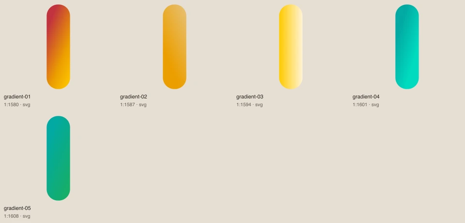
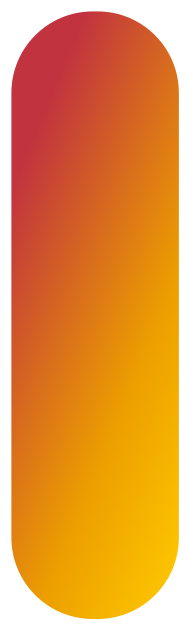
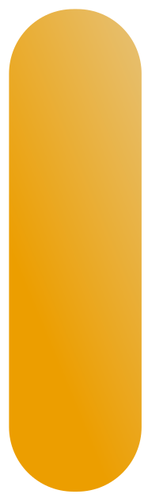
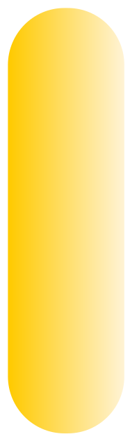

# Dégradés officiels

[Retour au catalogue](../assets.md)

## gradient-01

Échantillon sans légendes du dégradé officiel. Voir art-gradients.css pour les variantes observées.

- Fichier : [gradients/gradient-01.svg](../../etic-ui/assets/gradients/gradient-01.svg)
- Format : SVG, 188 × 628 px, 0.5 Ko
- [Source Figma 1:1580](https://www.figma.com/design/eofQFq1bCM8Ooe5KXBDRsk?node-id=1-1580)

## gradient-02

Échantillon sans légendes du dégradé officiel. Voir art-gradients.css pour les variantes observées.

- Fichier : [gradients/gradient-02.svg](../../etic-ui/assets/gradients/gradient-02.svg)
- Format : SVG, 188 × 628 px, 0.5 Ko
- [Source Figma 1:1587](https://www.figma.com/design/eofQFq1bCM8Ooe5KXBDRsk?node-id=1-1587)

## gradient-03

Échantillon sans légendes du dégradé officiel. Voir art-gradients.css pour les variantes observées.

- Fichier : [gradients/gradient-03.svg](../../etic-ui/assets/gradients/gradient-03.svg)
- Format : SVG, 188 × 628 px, 0.5 Ko
- [Source Figma 1:1594](https://www.figma.com/design/eofQFq1bCM8Ooe5KXBDRsk?node-id=1-1594)

## gradient-04

Échantillon sans légendes du dégradé officiel. Voir art-gradients.css pour les variantes observées.

- Fichier : [gradients/gradient-04.svg](../../etic-ui/assets/gradients/gradient-04.svg)
- Format : SVG, 188 × 628 px, 0.5 Ko
- [Source Figma 1:1601](https://www.figma.com/design/eofQFq1bCM8Ooe5KXBDRsk?node-id=1-1601)

## gradient-05

Échantillon sans légendes du dégradé officiel. Voir art-gradients.css pour les variantes observées.

- Fichier : [gradients/gradient-05.svg](../../etic-ui/assets/gradients/gradient-05.svg)
- Format : SVG, 188 × 628 px, 0.5 Ko
- [Source Figma 1:1608](https://www.figma.com/design/eofQFq1bCM8Ooe5KXBDRsk?node-id=1-1608)
