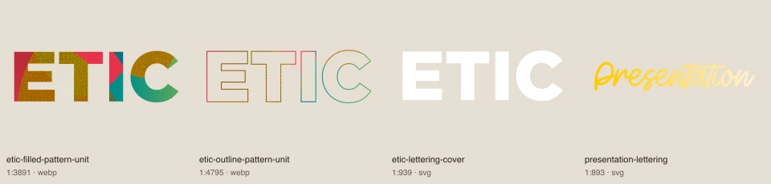
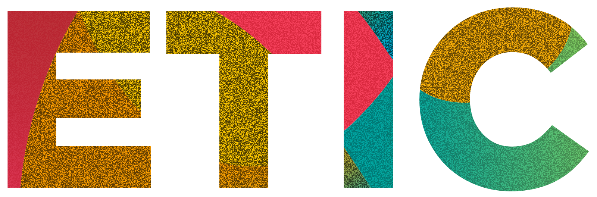
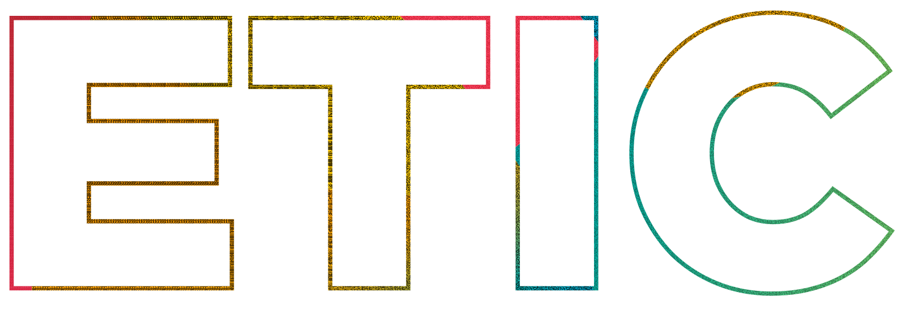

# Lettrages fixes

[Retour au catalogue](../assets.md)

## etic-filled-pattern-unit

Lettrage fixe exporté. Ne constitue pas une police ni une variante du logo.

- Fichier : [lettering/etic-filled-pattern-unit.webp](../../etic-ui/assets/lettering/etic-filled-pattern-unit.webp)
- Format : WEBP, 1600 × 528 px, 179.2 Ko
- [Source Figma 1:3891](https://www.figma.com/design/eofQFq1bCM8Ooe5KXBDRsk?node-id=1-3891)

## etic-outline-pattern-unit

Lettrage fixe exporté. Ne constitue pas une police ni une variante du logo.

- Fichier : [lettering/etic-outline-pattern-unit.webp](../../etic-ui/assets/lettering/etic-outline-pattern-unit.webp)
- Format : WEBP, 1600 × 546 px, 56.9 Ko
- [Source Figma 1:4795](https://www.figma.com/design/eofQFq1bCM8Ooe5KXBDRsk?node-id=1-4795)

## etic-lettering-cover

Lettrage fixe exporté. Ne constitue pas une police ni une variante du logo.

- Fichier : [lettering/etic-lettering-cover.svg](../../etic-ui/assets/lettering/etic-lettering-cover.svg)
- Format : SVG, 392 × 136 px, 0.9 Ko
- [Source Figma 1:939](https://www.figma.com/design/eofQFq1bCM8Ooe5KXBDRsk?node-id=1-939)

## presentation-lettering

Lettrage fixe exporté. Ne constitue pas une police ni une variante du logo.

- Fichier : [lettering/presentation-lettering.svg](../../etic-ui/assets/lettering/presentation-lettering.svg)
- Format : SVG, 408 × 88 px, 17.6 Ko
- [Source Figma 1:893](https://www.figma.com/design/eofQFq1bCM8Ooe5KXBDRsk?node-id=1-893)

## heading-logo

Lettrage fixe exporté. Ne constitue pas une police ni une variante du logo.

- Fichier : [lettering/heading-logo.svg](../../etic-ui/assets/lettering/heading-logo.svg)
- Format : SVG, 379 × 94 px, 4.4 Ko
- [Source Figma 1:1379](https://www.figma.com/design/eofQFq1bCM8Ooe5KXBDRsk?node-id=1-1379)

## heading-variation

Lettrage fixe exporté. Ne constitue pas une police ni une variante du logo.

- Fichier : [lettering/heading-variation.svg](../../etic-ui/assets/lettering/heading-variation.svg)
- Format : SVG, 381 × 87 px, 11.3 Ko
- [Source Figma 1:1384](https://www.figma.com/design/eofQFq1bCM8Ooe5KXBDRsk?node-id=1-1384)
