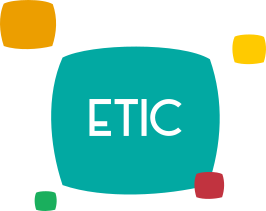

# Logos

[Retour au catalogue](../assets.md)

## etic-color

Emblème officiel. Conserver les couleurs et la zone 2x.

- Fichier : [logos/etic-color.svg](../../etic-ui/assets/logos/etic-color.svg)
- Format : SVG, 266 × 211 px, 3.1 Ko
- [Source Figma 1:3653](https://www.figma.com/design/eofQFq1bCM8Ooe5KXBDRsk?node-id=1-3653)

## etic-white

Emblème officiel. Conserver les couleurs et la zone 2x.

- Fichier : [logos/etic-white.svg](../../etic-ui/assets/logos/etic-white.svg)
- Format : SVG, 283 × 225 px, 2.9 Ko
- [Source Figma 1:1365](https://www.figma.com/design/eofQFq1bCM8Ooe5KXBDRsk?node-id=1-1365)
