# Formes libres

[Retour au catalogue](../assets.md)

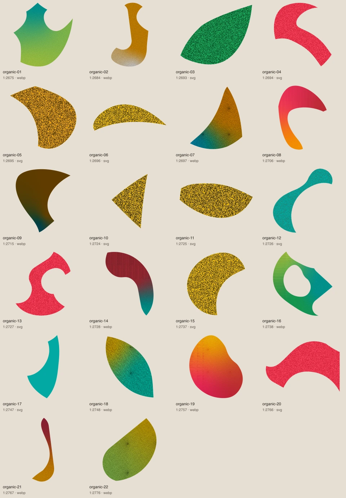

## organic-01

Forme libre isolée. Les effets et couleurs de cette illustration ne créent pas de nouvelles couleurs officielles.

- Fichier : [organic/organic-01.webp](../../etic-ui/assets/organic/organic-01.webp)
- Format : WEBP, 1497 × 1600 px, 513.1 Ko
- [Source Figma 1:2675](https://www.figma.com/design/eofQFq1bCM8Ooe5KXBDRsk?node-id=1-2675)

## organic-02

Forme libre isolée. Les effets et couleurs de cette illustration ne créent pas de nouvelles couleurs officielles.

- Fichier : [organic/organic-02.webp](../../etic-ui/assets/organic/organic-02.webp)
- Format : WEBP, 938 × 1600 px, 281.6 Ko
- [Source Figma 1:2684](https://www.figma.com/design/eofQFq1bCM8Ooe5KXBDRsk?node-id=1-2684)

## organic-03

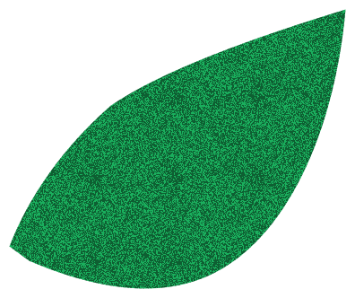

Forme libre isolée. Les effets et couleurs de cette illustration ne créent pas de nouvelles couleurs officielles.

- Fichier : [organic/organic-03.svg](../../etic-ui/assets/organic/organic-03.svg)
- Format : SVG, 396 × 332 px, 1.6 Ko
- [Source Figma 1:2693](https://www.figma.com/design/eofQFq1bCM8Ooe5KXBDRsk?node-id=1-2693)

## organic-04

Forme libre isolée. Les effets et couleurs de cette illustration ne créent pas de nouvelles couleurs officielles.

- Fichier : [organic/organic-04.svg](../../etic-ui/assets/organic/organic-04.svg)
- Format : SVG, 680 × 744 px, 2.1 Ko
- [Source Figma 1:2694](https://www.figma.com/design/eofQFq1bCM8Ooe5KXBDRsk?node-id=1-2694)

## organic-05

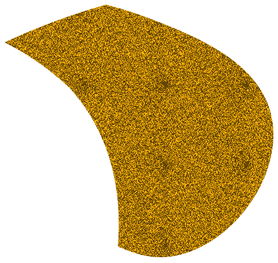

Forme libre isolée. Les effets et couleurs de cette illustration ne créent pas de nouvelles couleurs officielles.

- Fichier : [organic/organic-05.svg](../../etic-ui/assets/organic/organic-05.svg)
- Format : SVG, 472 × 448 px, 1.7 Ko
- [Source Figma 1:2695](https://www.figma.com/design/eofQFq1bCM8Ooe5KXBDRsk?node-id=1-2695)

## organic-06

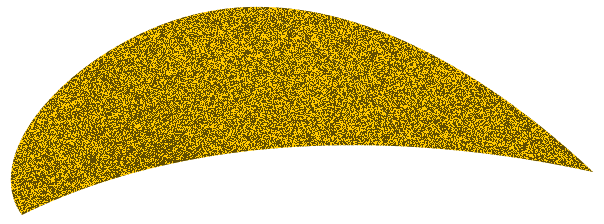

Forme libre isolée. Les effets et couleurs de cette illustration ne créent pas de nouvelles couleurs officielles.

- Fichier : [organic/organic-06.svg](../../etic-ui/assets/organic/organic-06.svg)
- Format : SVG, 604 × 224 px, 1.8 Ko
- [Source Figma 1:2696](https://www.figma.com/design/eofQFq1bCM8Ooe5KXBDRsk?node-id=1-2696)

## organic-07

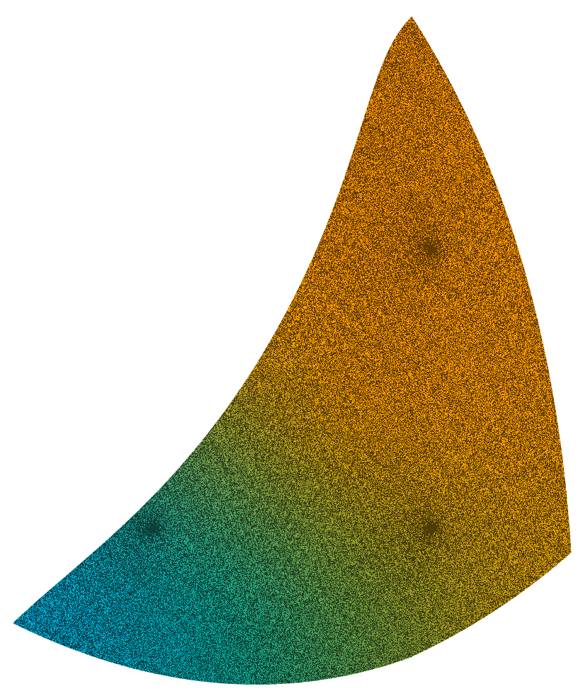

Forme libre isolée. Les effets et couleurs de cette illustration ne créent pas de nouvelles couleurs officielles.

- Fichier : [organic/organic-07.webp](../../etic-ui/assets/organic/organic-07.webp)
- Format : WEBP, 823 × 983 px, 217.2 Ko
- [Source Figma 1:2697](https://www.figma.com/design/eofQFq1bCM8Ooe5KXBDRsk?node-id=1-2697)

## organic-08

Forme libre isolée. Les effets et couleurs de cette illustration ne créent pas de nouvelles couleurs officielles.

- Fichier : [organic/organic-08.webp](../../etic-ui/assets/organic/organic-08.webp)
- Format : WEBP, 1222 × 1600 px, 274.9 Ko
- [Source Figma 1:2706](https://www.figma.com/design/eofQFq1bCM8Ooe5KXBDRsk?node-id=1-2706)

## organic-09

Forme libre isolée. Les effets et couleurs de cette illustration ne créent pas de nouvelles couleurs officielles.

- Fichier : [organic/organic-09.webp](../../etic-ui/assets/organic/organic-09.webp)
- Format : WEBP, 1320 × 1512 px, 76.9 Ko
- [Source Figma 1:2715](https://www.figma.com/design/eofQFq1bCM8Ooe5KXBDRsk?node-id=1-2715)

## organic-10

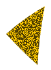

Forme libre isolée. Les effets et couleurs de cette illustration ne créent pas de nouvelles couleurs officielles.

- Fichier : [organic/organic-10.svg](../../etic-ui/assets/organic/organic-10.svg)
- Format : SVG, 76 × 104 px, 1.5 Ko
- [Source Figma 1:2724](https://www.figma.com/design/eofQFq1bCM8Ooe5KXBDRsk?node-id=1-2724)

## organic-11

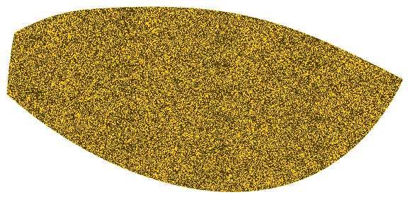

Forme libre isolée. Les effets et couleurs de cette illustration ne créent pas de nouvelles couleurs officielles.

- Fichier : [organic/organic-11.svg](../../etic-ui/assets/organic/organic-11.svg)
- Format : SVG, 579 × 280 px, 1.5 Ko
- [Source Figma 1:2725](https://www.figma.com/design/eofQFq1bCM8Ooe5KXBDRsk?node-id=1-2725)

## organic-12

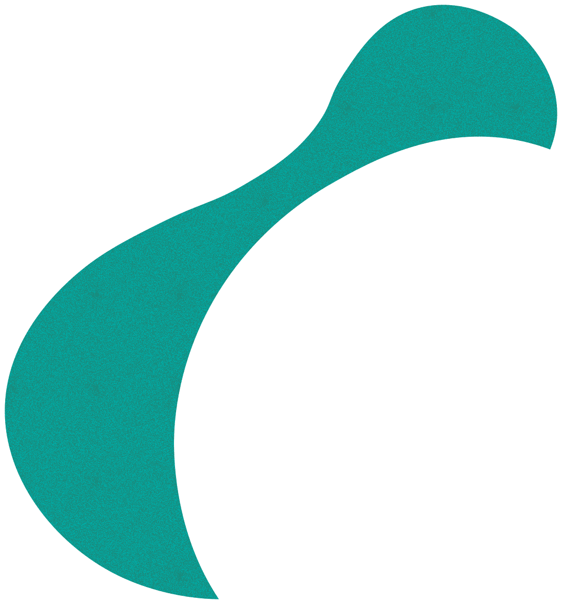

Forme libre isolée. Les effets et couleurs de cette illustration ne créent pas de nouvelles couleurs officielles.

- Fichier : [organic/organic-12.svg](../../etic-ui/assets/organic/organic-12.svg)
- Format : SVG, 1096 × 1176 px, 2.1 Ko
- [Source Figma 1:2726](https://www.figma.com/design/eofQFq1bCM8Ooe5KXBDRsk?node-id=1-2726)

## organic-13

Forme libre isolée. Les effets et couleurs de cette illustration ne créent pas de nouvelles couleurs officielles.

- Fichier : [organic/organic-13.svg](../../etic-ui/assets/organic/organic-13.svg)
- Format : SVG, 948 × 1104 px, 2.2 Ko
- [Source Figma 1:2727](https://www.figma.com/design/eofQFq1bCM8Ooe5KXBDRsk?node-id=1-2727)

## organic-14

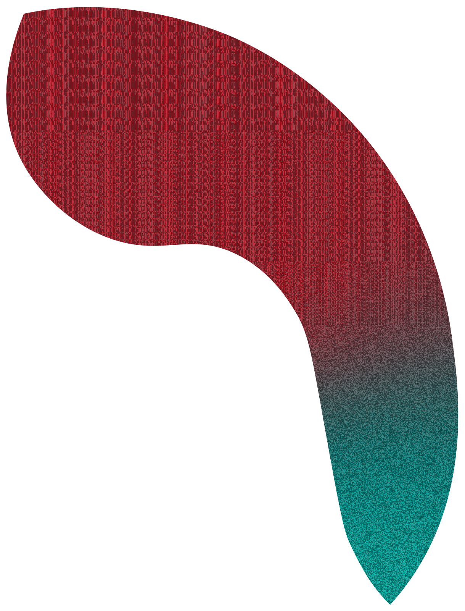

Forme libre isolée. Les effets et couleurs de cette illustration ne créent pas de nouvelles couleurs officielles.

- Fichier : [organic/organic-14.webp](../../etic-ui/assets/organic/organic-14.webp)
- Format : WEBP, 1219 × 1600 px, 233.7 Ko
- [Source Figma 1:2728](https://www.figma.com/design/eofQFq1bCM8Ooe5KXBDRsk?node-id=1-2728)

## organic-15

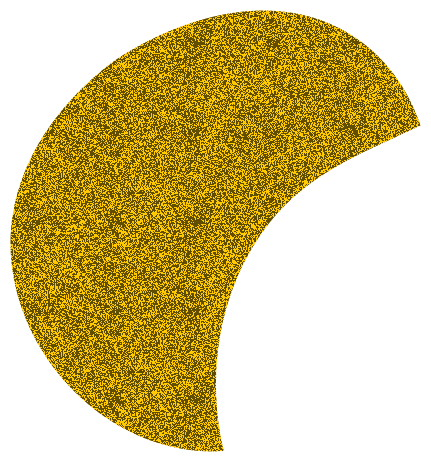

Forme libre isolée. Les effets et couleurs de cette illustration ne créent pas de nouvelles couleurs officielles.

- Fichier : [organic/organic-15.svg](../../etic-ui/assets/organic/organic-15.svg)
- Format : SVG, 432 × 460 px, 1.7 Ko
- [Source Figma 1:2737](https://www.figma.com/design/eofQFq1bCM8Ooe5KXBDRsk?node-id=1-2737)

## organic-16

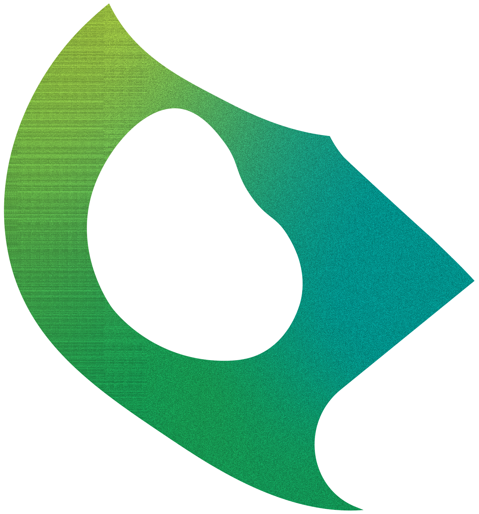

Forme libre isolée. Les effets et couleurs de cette illustration ne créent pas de nouvelles couleurs officielles.

- Fichier : [organic/organic-16.webp](../../etic-ui/assets/organic/organic-16.webp)
- Format : WEBP, 1490 × 1600 px, 372.8 Ko
- [Source Figma 1:2738](https://www.figma.com/design/eofQFq1bCM8Ooe5KXBDRsk?node-id=1-2738)

## organic-17

Forme libre isolée. Les effets et couleurs de cette illustration ne créent pas de nouvelles couleurs officielles.

- Fichier : [organic/organic-17.svg](../../etic-ui/assets/organic/organic-17.svg)
- Format : SVG, 324 × 619 px, 0.5 Ko
- [Source Figma 1:2747](https://www.figma.com/design/eofQFq1bCM8Ooe5KXBDRsk?node-id=1-2747)

## organic-18

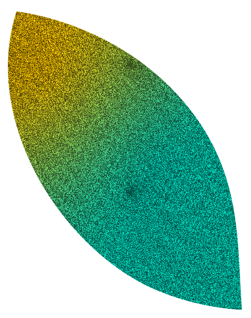

Forme libre isolée. Les effets et couleurs de cette illustration ne créent pas de nouvelles couleurs officielles.

- Fichier : [organic/organic-18.webp](../../etic-ui/assets/organic/organic-18.webp)
- Format : WEBP, 512 × 648 px, 125.2 Ko
- [Source Figma 1:2748](https://www.figma.com/design/eofQFq1bCM8Ooe5KXBDRsk?node-id=1-2748)

## organic-19

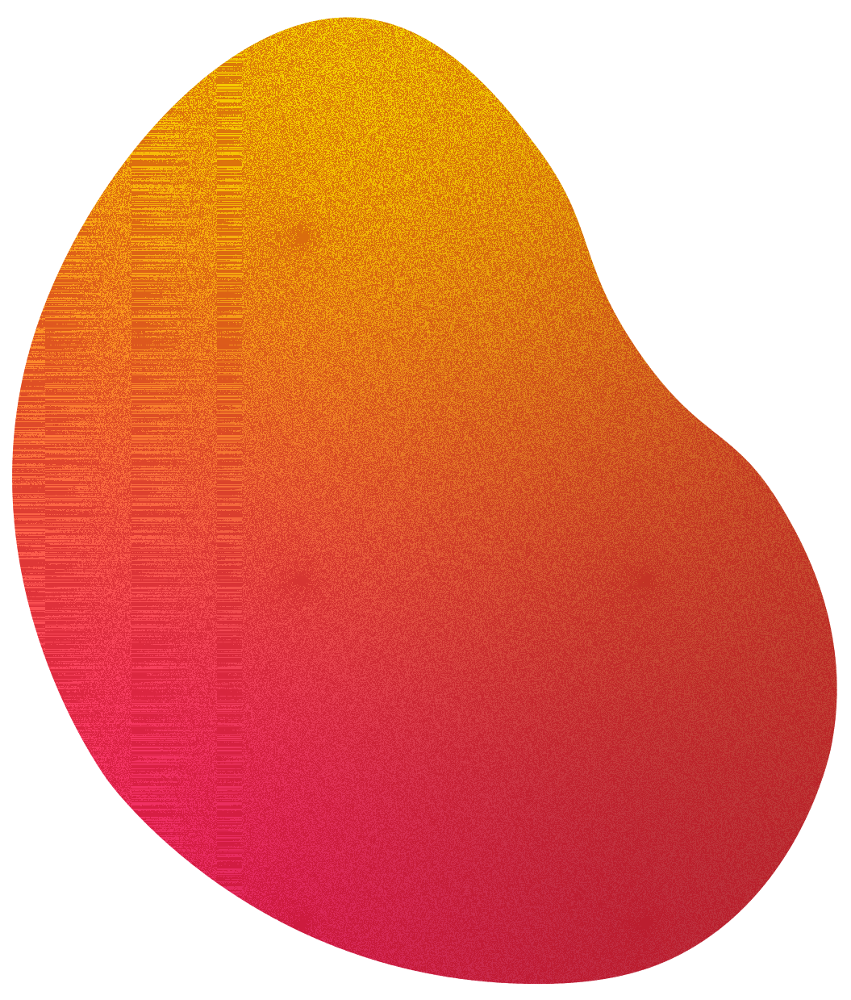

Forme libre isolée. Les effets et couleurs de cette illustration ne créent pas de nouvelles couleurs officielles.

- Fichier : [organic/organic-19.webp](../../etic-ui/assets/organic/organic-19.webp)
- Format : WEBP, 1055 × 1239 px, 436.9 Ko
- [Source Figma 1:2757](https://www.figma.com/design/eofQFq1bCM8Ooe5KXBDRsk?node-id=1-2757)

## organic-20

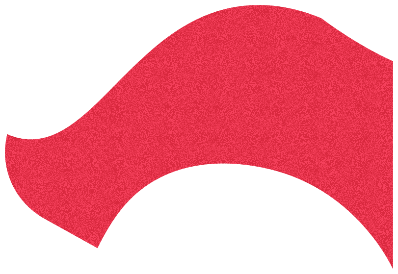

Forme libre isolée. Les effets et couleurs de cette illustration ne créent pas de nouvelles couleurs officielles.

- Fichier : [organic/organic-20.svg](../../etic-ui/assets/organic/organic-20.svg)
- Format : SVG, 812 × 560 px, 1.8 Ko
- [Source Figma 1:2766](https://www.figma.com/design/eofQFq1bCM8Ooe5KXBDRsk?node-id=1-2766)

## organic-21

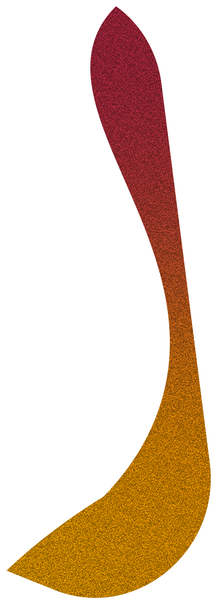

Forme libre isolée. Les effets et couleurs de cette illustration ne créent pas de nouvelles couleurs officielles.

- Fichier : [organic/organic-21.webp](../../etic-ui/assets/organic/organic-21.webp)
- Format : WEBP, 579 × 1600 px, 114.9 Ko
- [Source Figma 1:2767](https://www.figma.com/design/eofQFq1bCM8Ooe5KXBDRsk?node-id=1-2767)

## organic-22

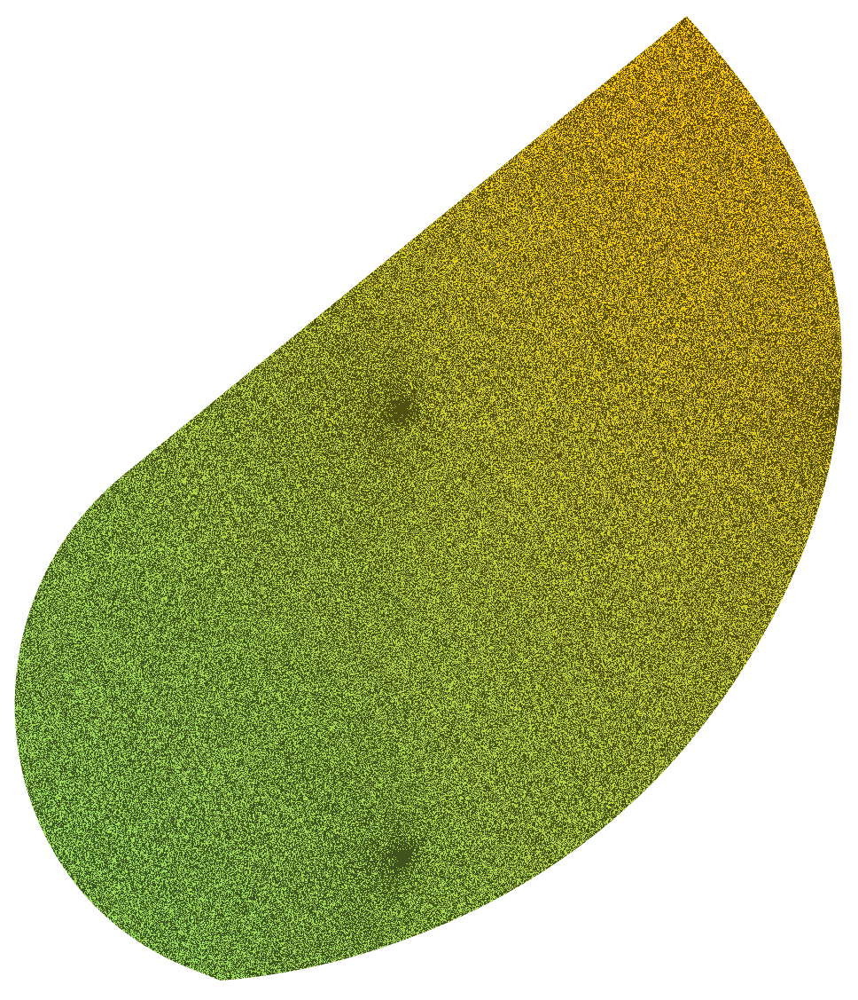

Forme libre isolée. Les effets et couleurs de cette illustration ne créent pas de nouvelles couleurs officielles.

- Fichier : [organic/organic-22.webp](../../etic-ui/assets/organic/organic-22.webp)
- Format : WEBP, 968 × 1127 px, 292.2 Ko
- [Source Figma 1:2776](https://www.figma.com/design/eofQFq1bCM8Ooe5KXBDRsk?node-id=1-2776)
