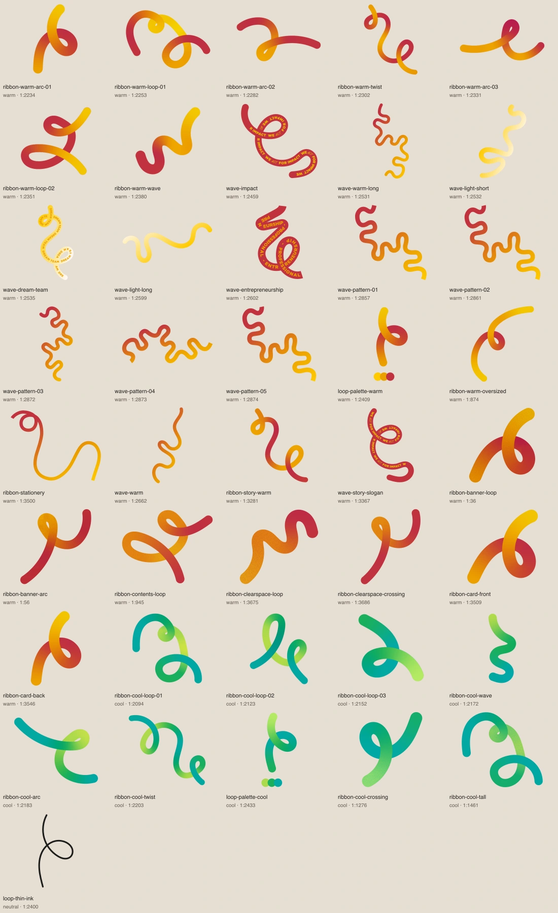
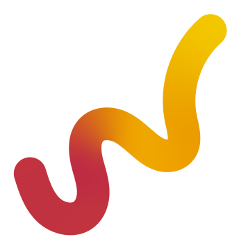
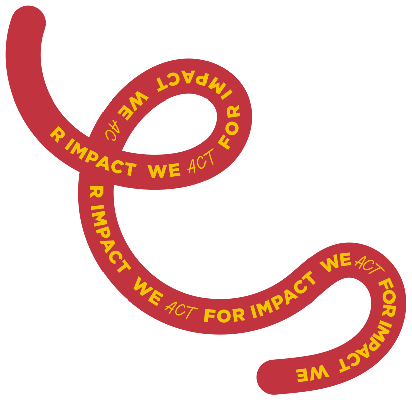
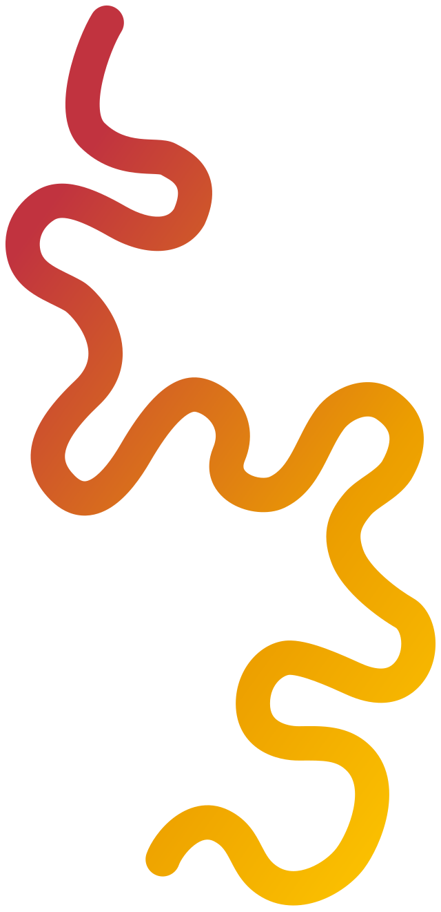
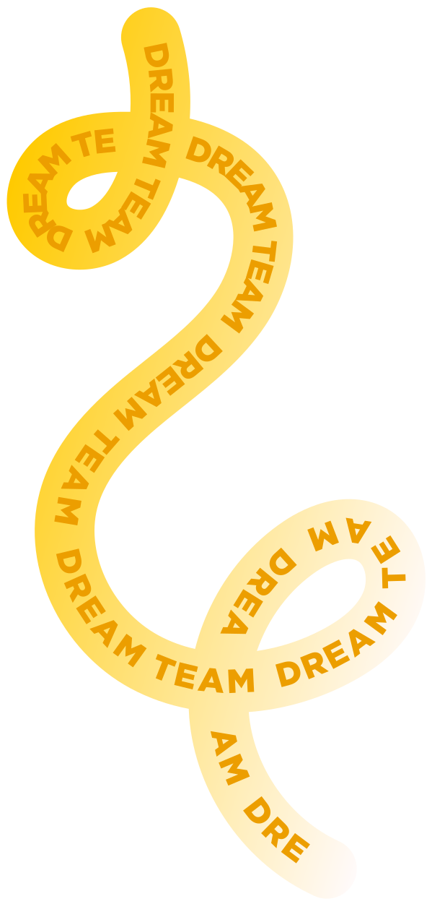
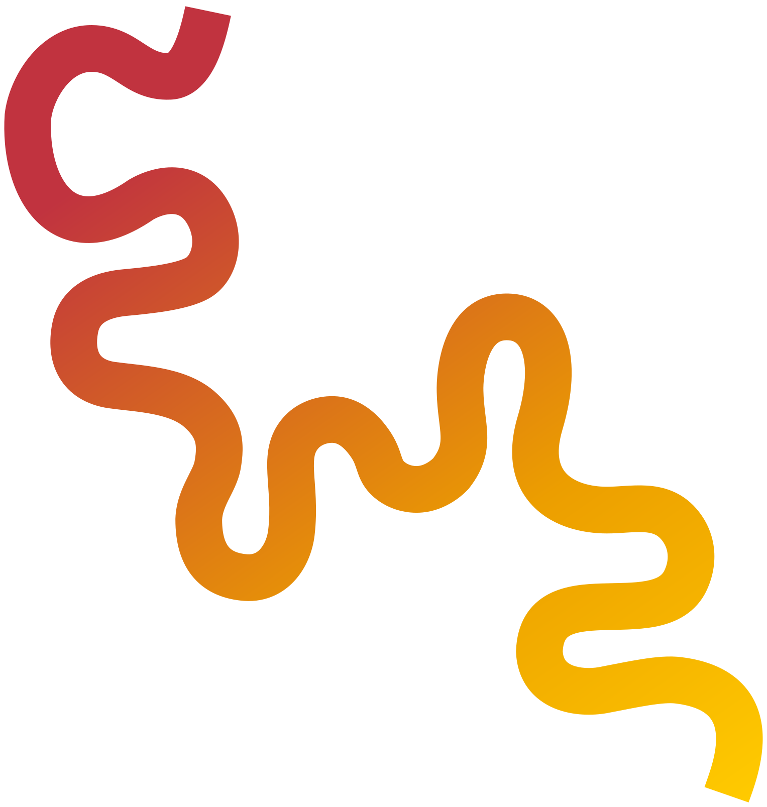
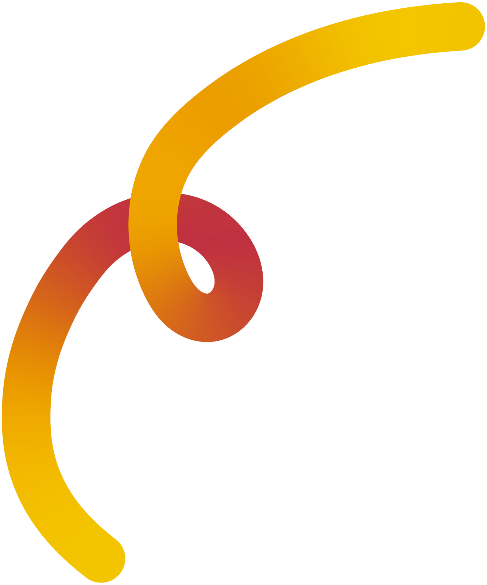
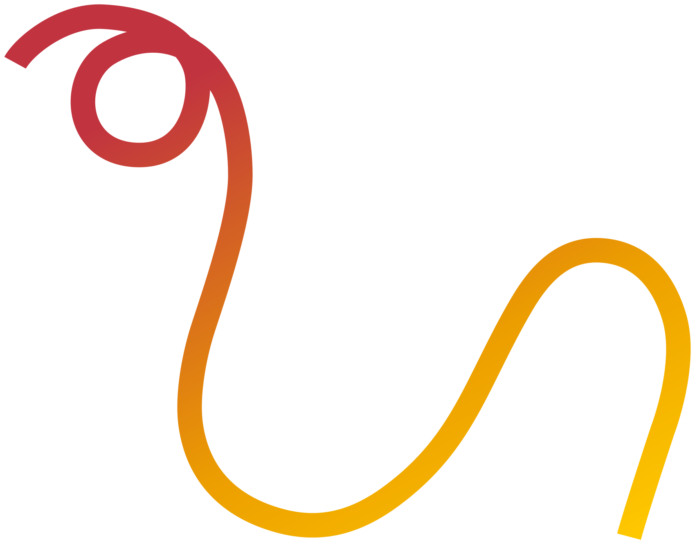
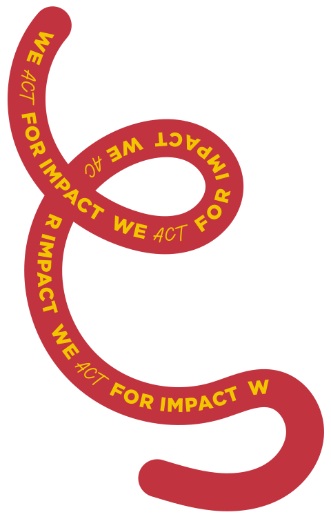

# Rubans

[Retour au catalogue](../assets.md)

## ribbon-cool-loop-01

Ruban isolé. Réserver une marge ou une zone de décoration.

- Famille de rubans : **cool**. Garder une seule famille colorée sur toute la page.

- Niveau : **ribbon**

**Association de composition (direction du projet, pas nouvelle règle officielle)**

Fond beige et accents compatibles ; pas de grand fond rouge.

À éviter : Ne pas mélanger avec des rubans warm ailleurs sur la même page ; ne pas superposer à un grand fond rouge.

Choisir un asset chaud existant : ribbon-warm-loop-01, ribbon-warm-loop-02 ou wave-light-short. Ne pas recolorer ce fichier.

- Fichier : [ribbons/cool/ribbon-cool-loop-01.webp](../../etic-ui/assets/ribbons/cool/ribbon-cool-loop-01.webp)
- Format : WEBP, 416 × 416 px, 21.4 Ko
- [Source Figma 1:2094](https://www.figma.com/design/eofQFq1bCM8Ooe5KXBDRsk?node-id=1-2094)

## ribbon-cool-loop-02

Ruban isolé. Réserver une marge ou une zone de décoration.

- Famille de rubans : **cool**. Garder une seule famille colorée sur toute la page.

- Niveau : **ribbon**

**Association de composition (direction du projet, pas nouvelle règle officielle)**

Fond beige et accents compatibles ; pas de grand fond rouge.

À éviter : Ne pas mélanger avec des rubans warm ailleurs sur la même page ; ne pas superposer à un grand fond rouge.

Choisir un asset chaud existant : ribbon-warm-loop-01, ribbon-warm-loop-02 ou wave-light-short. Ne pas recolorer ce fichier.

- Fichier : [ribbons/cool/ribbon-cool-loop-02.webp](../../etic-ui/assets/ribbons/cool/ribbon-cool-loop-02.webp)
- Format : WEBP, 359 × 415 px, 20.2 Ko
- [Source Figma 1:2123](https://www.figma.com/design/eofQFq1bCM8Ooe5KXBDRsk?node-id=1-2123)

## ribbon-cool-loop-03

Ruban isolé. Réserver une marge ou une zone de décoration.

- Famille de rubans : **cool**. Garder une seule famille colorée sur toute la page.

- Niveau : **ribbon**

**Association de composition (direction du projet, pas nouvelle règle officielle)**

Fond beige et accents compatibles ; pas de grand fond rouge.

À éviter : Ne pas mélanger avec des rubans warm ailleurs sur la même page ; ne pas superposer à un grand fond rouge.

Choisir un asset chaud existant : ribbon-warm-loop-01, ribbon-warm-loop-02 ou wave-light-short. Ne pas recolorer ce fichier.

- Fichier : [ribbons/cool/ribbon-cool-loop-03.webp](../../etic-ui/assets/ribbons/cool/ribbon-cool-loop-03.webp)
- Format : WEBP, 304 × 312 px, 14.3 Ko
- [Source Figma 1:2152](https://www.figma.com/design/eofQFq1bCM8Ooe5KXBDRsk?node-id=1-2152)

## ribbon-cool-wave

Ruban isolé. Réserver une marge ou une zone de décoration.

- Famille de rubans : **cool**. Garder une seule famille colorée sur toute la page.

- Niveau : **ribbon**

**Association de composition (direction du projet, pas nouvelle règle officielle)**

Fond beige et accents compatibles ; pas de grand fond rouge.

À éviter : Ne pas mélanger avec des rubans warm ailleurs sur la même page ; ne pas superposer à un grand fond rouge.

Choisir un asset chaud existant : ribbon-warm-loop-01, ribbon-warm-loop-02 ou wave-light-short. Ne pas recolorer ce fichier.

- Fichier : [ribbons/cool/ribbon-cool-wave.webp](../../etic-ui/assets/ribbons/cool/ribbon-cool-wave.webp)
- Format : WEBP, 191 × 407 px, 10.7 Ko
- [Source Figma 1:2172](https://www.figma.com/design/eofQFq1bCM8Ooe5KXBDRsk?node-id=1-2172)

## ribbon-cool-arc

Ruban isolé. Réserver une marge ou une zone de décoration.

- Famille de rubans : **cool**. Garder une seule famille colorée sur toute la page.

- Niveau : **ribbon**

**Association de composition (direction du projet, pas nouvelle règle officielle)**

Fond beige et accents compatibles ; pas de grand fond rouge.

À éviter : Ne pas mélanger avec des rubans warm ailleurs sur la même page ; ne pas superposer à un grand fond rouge.

Choisir un asset chaud existant : ribbon-warm-loop-01, ribbon-warm-loop-02 ou wave-light-short. Ne pas recolorer ce fichier.

- Fichier : [ribbons/cool/ribbon-cool-arc.webp](../../etic-ui/assets/ribbons/cool/ribbon-cool-arc.webp)
- Format : WEBP, 440 × 360 px, 14.7 Ko
- [Source Figma 1:2183](https://www.figma.com/design/eofQFq1bCM8Ooe5KXBDRsk?node-id=1-2183)

## ribbon-cool-twist

Ruban isolé. Réserver une marge ou une zone de décoration.

- Famille de rubans : **cool**. Garder une seule famille colorée sur toute la page.

- Niveau : **ribbon**

**Association de composition (direction du projet, pas nouvelle règle officielle)**

Fond beige et accents compatibles ; pas de grand fond rouge.

À éviter : Ne pas mélanger avec des rubans warm ailleurs sur la même page ; ne pas superposer à un grand fond rouge.

Choisir un asset chaud existant : ribbon-warm-loop-01, ribbon-warm-loop-02 ou wave-light-short. Ne pas recolorer ce fichier.

- Fichier : [ribbons/cool/ribbon-cool-twist.webp](../../etic-ui/assets/ribbons/cool/ribbon-cool-twist.webp)
- Format : WEBP, 560 × 512 px, 28.2 Ko
- [Source Figma 1:2203](https://www.figma.com/design/eofQFq1bCM8Ooe5KXBDRsk?node-id=1-2203)

## ribbon-warm-arc-01

Ruban isolé. Réserver une marge ou une zone de décoration.

- Famille de rubans : **warm**. Garder une seule famille colorée sur toute la page.

- Niveau : **ribbon**

**Association de composition (direction du projet, pas nouvelle règle officielle)**

Fond beige, ou bandeau rouge avec parties jaune/orange claires visibles.

À éviter : Ne pas mélanger avec des rubans cool ailleurs sur la même page.

- Fichier : [ribbons/warm/ribbon-warm-arc-01.webp](../../etic-ui/assets/ribbons/warm/ribbon-warm-arc-01.webp)
- Format : WEBP, 272 × 399 px, 14.1 Ko
- [Source Figma 1:2234](https://www.figma.com/design/eofQFq1bCM8Ooe5KXBDRsk?node-id=1-2234)

## ribbon-warm-loop-01

Ruban isolé. Réserver une marge ou une zone de décoration.

- Famille de rubans : **warm**. Garder une seule famille colorée sur toute la page.

- Niveau : **ribbon**

**Association de composition (direction du projet, pas nouvelle règle officielle)**

Fond beige, ou bandeau rouge avec parties jaune/orange claires visibles.

À éviter : Ne pas mélanger avec des rubans cool ailleurs sur la même page.

- Fichier : [ribbons/warm/ribbon-warm-loop-01.webp](../../etic-ui/assets/ribbons/warm/ribbon-warm-loop-01.webp)
- Format : WEBP, 521 × 368 px, 22.3 Ko
- [Source Figma 1:2253](https://www.figma.com/design/eofQFq1bCM8Ooe5KXBDRsk?node-id=1-2253)

## ribbon-warm-arc-02

Ruban isolé. Réserver une marge ou une zone de décoration.

- Famille de rubans : **warm**. Garder une seule famille colorée sur toute la page.

- Niveau : **ribbon**

**Association de composition (direction du projet, pas nouvelle règle officielle)**

Fond beige, ou bandeau rouge avec parties jaune/orange claires visibles.

À éviter : Ne pas mélanger avec des rubans cool ailleurs sur la même page.

- Fichier : [ribbons/warm/ribbon-warm-arc-02.webp](../../etic-ui/assets/ribbons/warm/ribbon-warm-arc-02.webp)
- Format : WEBP, 495 × 280 px, 12.3 Ko
- [Source Figma 1:2282](https://www.figma.com/design/eofQFq1bCM8Ooe5KXBDRsk?node-id=1-2282)

## ribbon-warm-twist

Ruban isolé. Réserver une marge ou une zone de décoration.

- Famille de rubans : **warm**. Garder une seule famille colorée sur toute la page.

- Niveau : **ribbon**

**Association de composition (direction du projet, pas nouvelle règle officielle)**

Fond beige, ou bandeau rouge avec parties jaune/orange claires visibles.

À éviter : Ne pas mélanger avec des rubans cool ailleurs sur la même page.

- Fichier : [ribbons/warm/ribbon-warm-twist.webp](../../etic-ui/assets/ribbons/warm/ribbon-warm-twist.webp)
- Format : WEBP, 384 × 487 px, 20.4 Ko
- [Source Figma 1:2302](https://www.figma.com/design/eofQFq1bCM8Ooe5KXBDRsk?node-id=1-2302)

## ribbon-warm-arc-03

Ruban isolé. Réserver une marge ou une zone de décoration.

- Famille de rubans : **warm**. Garder une seule famille colorée sur toute la page.

- Niveau : **ribbon**

**Association de composition (direction du projet, pas nouvelle règle officielle)**

Fond beige, ou bandeau rouge avec parties jaune/orange claires visibles.

À éviter : Ne pas mélanger avec des rubans cool ailleurs sur la même page.

- Fichier : [ribbons/warm/ribbon-warm-arc-03.webp](../../etic-ui/assets/ribbons/warm/ribbon-warm-arc-03.webp)
- Format : WEBP, 415 × 231 px, 10.8 Ko
- [Source Figma 1:2331](https://www.figma.com/design/eofQFq1bCM8Ooe5KXBDRsk?node-id=1-2331)

## ribbon-warm-loop-02

Ruban isolé. Réserver une marge ou une zone de décoration.

- Famille de rubans : **warm**. Garder une seule famille colorée sur toute la page.

- Niveau : **ribbon**

**Association de composition (direction du projet, pas nouvelle règle officielle)**

Fond beige, ou bandeau rouge avec parties jaune/orange claires visibles.

À éviter : Ne pas mélanger avec des rubans cool ailleurs sur la même page.

- Fichier : [ribbons/warm/ribbon-warm-loop-02.webp](../../etic-ui/assets/ribbons/warm/ribbon-warm-loop-02.webp)
- Format : WEBP, 360 × 352 px, 16.3 Ko
- [Source Figma 1:2351](https://www.figma.com/design/eofQFq1bCM8Ooe5KXBDRsk?node-id=1-2351)

## ribbon-warm-wave

Ruban isolé. Réserver une marge ou une zone de décoration.

- Famille de rubans : **warm**. Garder une seule famille colorée sur toute la page.

- Niveau : **ribbon**

**Association de composition (direction du projet, pas nouvelle règle officielle)**

Fond beige, ou bandeau rouge avec parties jaune/orange claires visibles.

À éviter : Ne pas mélanger avec des rubans cool ailleurs sur la même page.

- Fichier : [ribbons/warm/ribbon-warm-wave.webp](../../etic-ui/assets/ribbons/warm/ribbon-warm-wave.webp)
- Format : WEBP, 344 × 360 px, 10.3 Ko
- [Source Figma 1:2380](https://www.figma.com/design/eofQFq1bCM8Ooe5KXBDRsk?node-id=1-2380)

## wave-impact

Courbe isolée. Éviter les contrôles et les textes.

- Famille de rubans : **warm**. Garder une seule famille colorée sur toute la page.

- Niveau : **ribbon**

**Association de composition (direction du projet, pas nouvelle règle officielle)**

Fond beige, ou bandeau rouge avec parties jaune/orange claires visibles.

À éviter : Ne pas mélanger avec des rubans cool ailleurs sur la même page.

- Fichier : [ribbons/warm/wave-impact.svg](../../etic-ui/assets/ribbons/warm/wave-impact.svg)
- Format : SVG, 820 × 796 px, 36.7 Ko
- [Source Figma 1:2459](https://www.figma.com/design/eofQFq1bCM8Ooe5KXBDRsk?node-id=1-2459)

## wave-warm-long

Courbe isolée. Éviter les contrôles et les textes.

- Famille de rubans : **warm**. Garder une seule famille colorée sur toute la page.

- Niveau : **ribbon**

**Association de composition (direction du projet, pas nouvelle règle officielle)**

Fond beige, ou bandeau rouge avec parties jaune/orange claires visibles.

À éviter : Ne pas mélanger avec des rubans cool ailleurs sur la même page.

- Fichier : [ribbons/warm/wave-warm-long.svg](../../etic-ui/assets/ribbons/warm/wave-warm-long.svg)
- Format : SVG, 640 × 1320 px, 7.4 Ko
- [Source Figma 1:2531](https://www.figma.com/design/eofQFq1bCM8Ooe5KXBDRsk?node-id=1-2531)

## wave-light-short

Courbe isolée. Éviter les contrôles et les textes.

- Famille de rubans : **warm**. Garder une seule famille colorée sur toute la page.

- Niveau : **ribbon**

**Association de composition (direction du projet, pas nouvelle règle officielle)**

Fond beige, ou bandeau rouge avec parties jaune/orange claires visibles.

À éviter : Ne pas mélanger avec des rubans cool ailleurs sur la même page.

- Fichier : [ribbons/warm/wave-light-short.svg](../../etic-ui/assets/ribbons/warm/wave-light-short.svg)
- Format : SVG, 340 × 515 px, 3.7 Ko
- [Source Figma 1:2532](https://www.figma.com/design/eofQFq1bCM8Ooe5KXBDRsk?node-id=1-2532)

## wave-dream-team

Courbe isolée. Éviter les contrôles et les textes.

- Famille de rubans : **warm**. Garder une seule famille colorée sur toute la page.

- Niveau : **ribbon**

**Association de composition (direction du projet, pas nouvelle règle officielle)**

Fond beige, ou bandeau rouge avec parties jaune/orange claires visibles.

À éviter : Ne pas mélanger avec des rubans cool ailleurs sur la même page.

- Fichier : [ribbons/warm/wave-dream-team.svg](../../etic-ui/assets/ribbons/warm/wave-dream-team.svg)
- Format : SVG, 600 × 1251 px, 20.2 Ko
- [Source Figma 1:2535](https://www.figma.com/design/eofQFq1bCM8Ooe5KXBDRsk?node-id=1-2535)

## wave-light-long

Courbe isolée. Éviter les contrôles et les textes.

- Famille de rubans : **warm**. Garder une seule famille colorée sur toute la page.

- Niveau : **ribbon**

**Association de composition (direction du projet, pas nouvelle règle officielle)**

Fond beige, ou bandeau rouge avec parties jaune/orange claires visibles.

À éviter : Ne pas mélanger avec des rubans cool ailleurs sur la même page.

- Fichier : [ribbons/warm/wave-light-long.svg](../../etic-ui/assets/ribbons/warm/wave-light-long.svg)
- Format : SVG, 1036 × 476 px, 2.7 Ko
- [Source Figma 1:2599](https://www.figma.com/design/eofQFq1bCM8Ooe5KXBDRsk?node-id=1-2599)

## wave-entrepreneurship

Courbe isolée. Éviter les contrôles et les textes.

- Famille de rubans : **warm**. Garder une seule famille colorée sur toute la page.

- Niveau : **ribbon**

**Association de composition (direction du projet, pas nouvelle règle officielle)**

Fond beige, ou bandeau rouge avec parties jaune/orange claires visibles.

À éviter : Ne pas mélanger avec des rubans cool ailleurs sur la même page.

- Fichier : [ribbons/warm/wave-entrepreneurship.svg](../../etic-ui/assets/ribbons/warm/wave-entrepreneurship.svg)
- Format : SVG, 372 × 564 px, 19.4 Ko
- [Source Figma 1:2602](https://www.figma.com/design/eofQFq1bCM8Ooe5KXBDRsk?node-id=1-2602)

## wave-pattern-01

Courbe isolée. Éviter les contrôles et les textes.

- Famille de rubans : **warm**. Garder une seule famille colorée sur toute la page.

- Niveau : **ribbon**

**Association de composition (direction du projet, pas nouvelle règle officielle)**

Fond beige, ou bandeau rouge avec parties jaune/orange claires visibles.

À éviter : Ne pas mélanger avec des rubans cool ailleurs sur la même page.

- Fichier : [ribbons/warm/wave-pattern-01.svg](../../etic-ui/assets/ribbons/warm/wave-pattern-01.svg)
- Format : SVG, 1528 × 1608 px, 7.2 Ko
- [Source Figma 1:2857](https://www.figma.com/design/eofQFq1bCM8Ooe5KXBDRsk?node-id=1-2857)

## wave-pattern-02

Courbe isolée. Éviter les contrôles et les textes.

- Famille de rubans : **warm**. Garder une seule famille colorée sur toute la page.

- Niveau : **ribbon**

**Association de composition (direction du projet, pas nouvelle règle officielle)**

Fond beige, ou bandeau rouge avec parties jaune/orange claires visibles.

À éviter : Ne pas mélanger avec des rubans cool ailleurs sur la même page.

- Fichier : [ribbons/warm/wave-pattern-02.svg](../../etic-ui/assets/ribbons/warm/wave-pattern-02.svg)
- Format : SVG, 1652 × 1636 px, 6.9 Ko
- [Source Figma 1:2861](https://www.figma.com/design/eofQFq1bCM8Ooe5KXBDRsk?node-id=1-2861)

## wave-pattern-03

Courbe isolée. Éviter les contrôles et les textes.

- Famille de rubans : **warm**. Garder une seule famille colorée sur toute la page.

- Niveau : **ribbon**

**Association de composition (direction du projet, pas nouvelle règle officielle)**

Fond beige, ou bandeau rouge avec parties jaune/orange claires visibles.

À éviter : Ne pas mélanger avec des rubans cool ailleurs sur la même page.

- Fichier : [ribbons/warm/wave-pattern-03.svg](../../etic-ui/assets/ribbons/warm/wave-pattern-03.svg)
- Format : SVG, 936 × 2083 px, 7.4 Ko
- [Source Figma 1:2872](https://www.figma.com/design/eofQFq1bCM8Ooe5KXBDRsk?node-id=1-2872)

## wave-pattern-04

Courbe isolée. Éviter les contrôles et les textes.

- Famille de rubans : **warm**. Garder une seule famille colorée sur toute la page.

- Niveau : **ribbon**

**Association de composition (direction du projet, pas nouvelle règle officielle)**

Fond beige, ou bandeau rouge avec parties jaune/orange claires visibles.

À éviter : Ne pas mélanger avec des rubans cool ailleurs sur la même page.

- Fichier : [ribbons/warm/wave-pattern-04.svg](../../etic-ui/assets/ribbons/warm/wave-pattern-04.svg)
- Format : SVG, 2076 × 896 px, 6.7 Ko
- [Source Figma 1:2873](https://www.figma.com/design/eofQFq1bCM8Ooe5KXBDRsk?node-id=1-2873)

## wave-pattern-05

Courbe isolée. Éviter les contrôles et les textes.

- Famille de rubans : **warm**. Garder une seule famille colorée sur toute la page.

- Niveau : **ribbon**

**Association de composition (direction du projet, pas nouvelle règle officielle)**

Fond beige, ou bandeau rouge avec parties jaune/orange claires visibles.

À éviter : Ne pas mélanger avec des rubans cool ailleurs sur la même page.

- Fichier : [ribbons/warm/wave-pattern-05.svg](../../etic-ui/assets/ribbons/warm/wave-pattern-05.svg)
- Format : SVG, 1552 × 1580 px, 7.1 Ko
- [Source Figma 1:2874](https://www.figma.com/design/eofQFq1bCM8Ooe5KXBDRsk?node-id=1-2874)

## loop-palette-warm

Composition existante. Conserver le rapport entre ses éléments.

- Famille de rubans : **warm**. Garder une seule famille colorée sur toute la page.

- Niveau : **ribbon**

**Association de composition (direction du projet, pas nouvelle règle officielle)**

Fond beige, ou bandeau rouge avec parties jaune/orange claires visibles.

À éviter : Ne pas mélanger avec des rubans cool ailleurs sur la même page.

- Fichier : [ribbons/warm/loop-palette-warm.webp](../../etic-ui/assets/ribbons/warm/loop-palette-warm.webp)
- Format : WEBP, 608 × 1263 px, 47.5 Ko
- [Source Figma 1:2409](https://www.figma.com/design/eofQFq1bCM8Ooe5KXBDRsk?node-id=1-2409)

## loop-palette-cool

Composition existante. Conserver le rapport entre ses éléments.

- Famille de rubans : **cool**. Garder une seule famille colorée sur toute la page.

- Niveau : **ribbon**

**Association de composition (direction du projet, pas nouvelle règle officielle)**

Fond beige et accents compatibles ; pas de grand fond rouge.

À éviter : Ne pas mélanger avec des rubans warm ailleurs sur la même page ; ne pas superposer à un grand fond rouge.

Choisir un asset chaud existant : ribbon-warm-loop-01, ribbon-warm-loop-02 ou wave-light-short. Ne pas recolorer ce fichier.

- Fichier : [ribbons/cool/loop-palette-cool.webp](../../etic-ui/assets/ribbons/cool/loop-palette-cool.webp)
- Format : WEBP, 623 × 1255 px, 47.4 Ko
- [Source Figma 1:2433](https://www.figma.com/design/eofQFq1bCM8Ooe5KXBDRsk?node-id=1-2433)

## ribbon-warm-oversized

Composition existante. Conserver le rapport entre ses éléments.

- Famille de rubans : **warm**. Garder une seule famille colorée sur toute la page.

- Niveau : **ribbon**

**Association de composition (direction du projet, pas nouvelle règle officielle)**

Fond beige, ou bandeau rouge avec parties jaune/orange claires visibles.

À éviter : Ne pas mélanger avec des rubans cool ailleurs sur la même page.

- Fichier : [ribbons/warm/ribbon-warm-oversized.webp](../../etic-ui/assets/ribbons/warm/ribbon-warm-oversized.webp)
- Format : WEBP, 1335 × 1600 px, 59.3 Ko
- [Source Figma 1:874](https://www.figma.com/design/eofQFq1bCM8Ooe5KXBDRsk?node-id=1-874)

## ribbon-cool-crossing

Composition existante. Conserver le rapport entre ses éléments.

- Famille de rubans : **cool**. Garder une seule famille colorée sur toute la page.

- Niveau : **ribbon**

**Association de composition (direction du projet, pas nouvelle règle officielle)**

Fond beige et accents compatibles ; pas de grand fond rouge.

À éviter : Ne pas mélanger avec des rubans warm ailleurs sur la même page ; ne pas superposer à un grand fond rouge.

Choisir un asset chaud existant : ribbon-warm-loop-01, ribbon-warm-loop-02 ou wave-light-short. Ne pas recolorer ce fichier.

- Fichier : [ribbons/cool/ribbon-cool-crossing.webp](../../etic-ui/assets/ribbons/cool/ribbon-cool-crossing.webp)
- Format : WEBP, 1356 × 1600 px, 872.5 Ko
- [Source Figma 1:1276](https://www.figma.com/design/eofQFq1bCM8Ooe5KXBDRsk?node-id=1-1276)

## ribbon-cool-tall

Composition existante. Conserver le rapport entre ses éléments.

- Famille de rubans : **cool**. Garder une seule famille colorée sur toute la page.

- Niveau : **ribbon**

**Association de composition (direction du projet, pas nouvelle règle officielle)**

Fond beige et accents compatibles ; pas de grand fond rouge.

À éviter : Ne pas mélanger avec des rubans warm ailleurs sur la même page ; ne pas superposer à un grand fond rouge.

Choisir un asset chaud existant : ribbon-warm-loop-01, ribbon-warm-loop-02 ou wave-light-short. Ne pas recolorer ce fichier.

- Fichier : [ribbons/cool/ribbon-cool-tall.webp](../../etic-ui/assets/ribbons/cool/ribbon-cool-tall.webp)
- Format : WEBP, 1600 × 1483 px, 800.9 Ko
- [Source Figma 1:1461](https://www.figma.com/design/eofQFq1bCM8Ooe5KXBDRsk?node-id=1-1461)

## ribbon-stationery

Composition existante. Conserver le rapport entre ses éléments.

- Famille de rubans : **warm**. Garder une seule famille colorée sur toute la page.

- Niveau : **ribbon**

**Association de composition (direction du projet, pas nouvelle règle officielle)**

Fond beige, ou bandeau rouge avec parties jaune/orange claires visibles.

À éviter : Ne pas mélanger avec des rubans cool ailleurs sur la même page.

- Fichier : [ribbons/warm/ribbon-stationery.svg](../../etic-ui/assets/ribbons/warm/ribbon-stationery.svg)
- Format : SVG, 1699 × 1332 px, 1.2 Ko
- [Source Figma 1:3500](https://www.figma.com/design/eofQFq1bCM8Ooe5KXBDRsk?node-id=1-3500)

## wave-warm

Courbe isolée. Éviter les contrôles et les textes.

- Famille de rubans : **warm**. Garder une seule famille colorée sur toute la page.

- Niveau : **ribbon**

**Association de composition (direction du projet, pas nouvelle règle officielle)**

Fond beige, ou bandeau rouge avec parties jaune/orange claires visibles.

À éviter : Ne pas mélanger avec des rubans cool ailleurs sur la même page.

- Fichier : [ribbons/warm/wave-warm.svg](../../etic-ui/assets/ribbons/warm/wave-warm.svg)
- Format : SVG, 323 × 791 px, 2.9 Ko
- [Source Figma 1:2662](https://www.figma.com/design/eofQFq1bCM8Ooe5KXBDRsk?node-id=1-2662)

## loop-thin-ink

Élément isolé de la composition source. Conserver ses proportions et réserver une zone décorative.

- Famille de rubans : **neutral**. Garder une seule famille colorée sur toute la page.

- Niveau : **ribbon**

**Association de composition (direction du projet, pas nouvelle règle officielle)**

Trait neutre pour un détail discret ; il ne définit pas une deuxième famille colorée.

À éviter : Ne pas utiliser comme substitut systématique aux choix de famille.

- Fichier : [ribbons/neutral/loop-thin-ink.svg](../../etic-ui/assets/ribbons/neutral/loop-thin-ink.svg)
- Format : SVG, 240 × 476 px, 0.9 Ko
- [Source Figma 1:2400](https://www.figma.com/design/eofQFq1bCM8Ooe5KXBDRsk?node-id=1-2400)

## ribbon-story-warm

Élément isolé de la composition source. Conserver ses proportions et réserver une zone décorative.

- Famille de rubans : **warm**. Garder une seule famille colorée sur toute la page.

- Niveau : **ribbon**

**Association de composition (direction du projet, pas nouvelle règle officielle)**

Fond beige, ou bandeau rouge avec parties jaune/orange claires visibles.

À éviter : Ne pas mélanger avec des rubans cool ailleurs sur la même page.

- Fichier : [ribbons/warm/ribbon-story-warm.webp](../../etic-ui/assets/ribbons/warm/ribbon-story-warm.webp)
- Format : WEBP, 1151 × 1471 px, 66.5 Ko
- [Source Figma 1:3281](https://www.figma.com/design/eofQFq1bCM8Ooe5KXBDRsk?node-id=1-3281)

## wave-story-slogan

Élément isolé de la composition source. Conserver ses proportions et réserver une zone décorative.

- Famille de rubans : **warm**. Garder une seule famille colorée sur toute la page.

- Niveau : **ribbon**

**Association de composition (direction du projet, pas nouvelle règle officielle)**

Fond beige, ou bandeau rouge avec parties jaune/orange claires visibles.

À éviter : Ne pas mélanger avec des rubans cool ailleurs sur la même page.

- Fichier : [ribbons/warm/wave-story-slogan.svg](../../etic-ui/assets/ribbons/warm/wave-story-slogan.svg)
- Format : SVG, 480 × 752 px, 34.4 Ko
- [Source Figma 1:3367](https://www.figma.com/design/eofQFq1bCM8Ooe5KXBDRsk?node-id=1-3367)

## ribbon-banner-loop

Ruban chaud exporté de son contexte source, sans fond de page. Choisir la même famille de rubans sur toute la page.

- Famille de rubans : **warm**. Garder une seule famille colorée sur toute la page.

- Niveau : **ribbon**

**Association de composition (direction du projet, pas nouvelle règle officielle)**

Fond beige, ou bandeau rouge avec parties jaune/orange claires visibles.

À éviter : Ne pas mélanger avec des rubans cool ailleurs sur la même page.

- Fichier : [ribbons/warm/ribbon-banner-loop.webp](../../etic-ui/assets/ribbons/warm/ribbon-banner-loop.webp)
- Format : WEBP, 1426 × 1600 px, 386.9 Ko
- [Source Figma 1:36](https://www.figma.com/design/eofQFq1bCM8Ooe5KXBDRsk?node-id=1-36)

## ribbon-banner-arc

Ruban chaud exporté de son contexte source, sans fond de page. Choisir la même famille de rubans sur toute la page.

- Famille de rubans : **warm**. Garder une seule famille colorée sur toute la page.

- Niveau : **ribbon**

**Association de composition (direction du projet, pas nouvelle règle officielle)**

Fond beige, ou bandeau rouge avec parties jaune/orange claires visibles.

À éviter : Ne pas mélanger avec des rubans cool ailleurs sur la même page.

- Fichier : [ribbons/warm/ribbon-banner-arc.webp](../../etic-ui/assets/ribbons/warm/ribbon-banner-arc.webp)
- Format : WEBP, 1511 × 1600 px, 259.0 Ko
- [Source Figma 1:56](https://www.figma.com/design/eofQFq1bCM8Ooe5KXBDRsk?node-id=1-56)

## ribbon-contents-loop

Ruban chaud exporté de son contexte source, sans fond de page. Choisir la même famille de rubans sur toute la page.

- Famille de rubans : **warm**. Garder une seule famille colorée sur toute la page.

- Niveau : **ribbon**

**Association de composition (direction du projet, pas nouvelle règle officielle)**

Fond beige, ou bandeau rouge avec parties jaune/orange claires visibles.

À éviter : Ne pas mélanger avec des rubans cool ailleurs sur la même page.

- Fichier : [ribbons/warm/ribbon-contents-loop.webp](../../etic-ui/assets/ribbons/warm/ribbon-contents-loop.webp)
- Format : WEBP, 1600 × 1297 px, 730.7 Ko
- [Source Figma 1:945](https://www.figma.com/design/eofQFq1bCM8Ooe5KXBDRsk?node-id=1-945)

## ribbon-clearspace-loop

Ruban chaud exporté de son contexte source, sans fond de page. Choisir la même famille de rubans sur toute la page.

- Famille de rubans : **warm**. Garder une seule famille colorée sur toute la page.

- Niveau : **ribbon**

**Association de composition (direction du projet, pas nouvelle règle officielle)**

Fond beige, ou bandeau rouge avec parties jaune/orange claires visibles.

À éviter : Ne pas mélanger avec des rubans cool ailleurs sur la même page.

- Fichier : [ribbons/warm/ribbon-clearspace-loop.webp](../../etic-ui/assets/ribbons/warm/ribbon-clearspace-loop.webp)
- Format : WEBP, 1600 × 1518 px, 180.6 Ko
- [Source Figma 1:3675](https://www.figma.com/design/eofQFq1bCM8Ooe5KXBDRsk?node-id=1-3675)

## ribbon-clearspace-crossing

Ruban chaud exporté de son contexte source, sans fond de page. Choisir la même famille de rubans sur toute la page.

- Famille de rubans : **warm**. Garder une seule famille colorée sur toute la page.

- Niveau : **ribbon**

**Association de composition (direction du projet, pas nouvelle règle officielle)**

Fond beige, ou bandeau rouge avec parties jaune/orange claires visibles.

À éviter : Ne pas mélanger avec des rubans cool ailleurs sur la même page.

- Fichier : [ribbons/warm/ribbon-clearspace-crossing.webp](../../etic-ui/assets/ribbons/warm/ribbon-clearspace-crossing.webp)
- Format : WEBP, 1279 × 1600 px, 476.5 Ko
- [Source Figma 1:3686](https://www.figma.com/design/eofQFq1bCM8Ooe5KXBDRsk?node-id=1-3686)

## ribbon-card-front

Ruban chaud exporté de son contexte source, sans fond de page. Choisir la même famille de rubans sur toute la page.

- Famille de rubans : **warm**. Garder une seule famille colorée sur toute la page.

- Niveau : **ribbon**

**Association de composition (direction du projet, pas nouvelle règle officielle)**

Fond beige, ou bandeau rouge avec parties jaune/orange claires visibles.

À éviter : Ne pas mélanger avec des rubans cool ailleurs sur la même page.

- Fichier : [ribbons/warm/ribbon-card-front.webp](../../etic-ui/assets/ribbons/warm/ribbon-card-front.webp)
- Format : WEBP, 1319 × 1383 px, 94.9 Ko
- [Source Figma 1:3509](https://www.figma.com/design/eofQFq1bCM8Ooe5KXBDRsk?node-id=1-3509)

## ribbon-card-back

Ruban chaud exporté de son contexte source, sans fond de page. Choisir la même famille de rubans sur toute la page.

- Famille de rubans : **warm**. Garder une seule famille colorée sur toute la page.

- Niveau : **ribbon**

**Association de composition (direction du projet, pas nouvelle règle officielle)**

Fond beige, ou bandeau rouge avec parties jaune/orange claires visibles.

À éviter : Ne pas mélanger avec des rubans cool ailleurs sur la même page.

- Fichier : [ribbons/warm/ribbon-card-back.webp](../../etic-ui/assets/ribbons/warm/ribbon-card-back.webp)
- Format : WEBP, 1100 × 1600 px, 89.5 Ko
- [Source Figma 1:3546](https://www.figma.com/design/eofQFq1bCM8Ooe5KXBDRsk?node-id=1-3546)
