# Stickers

[Retour au catalogue](../assets.md)

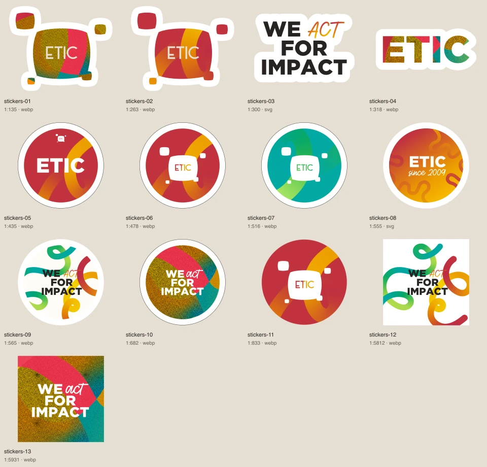

## stickers-01

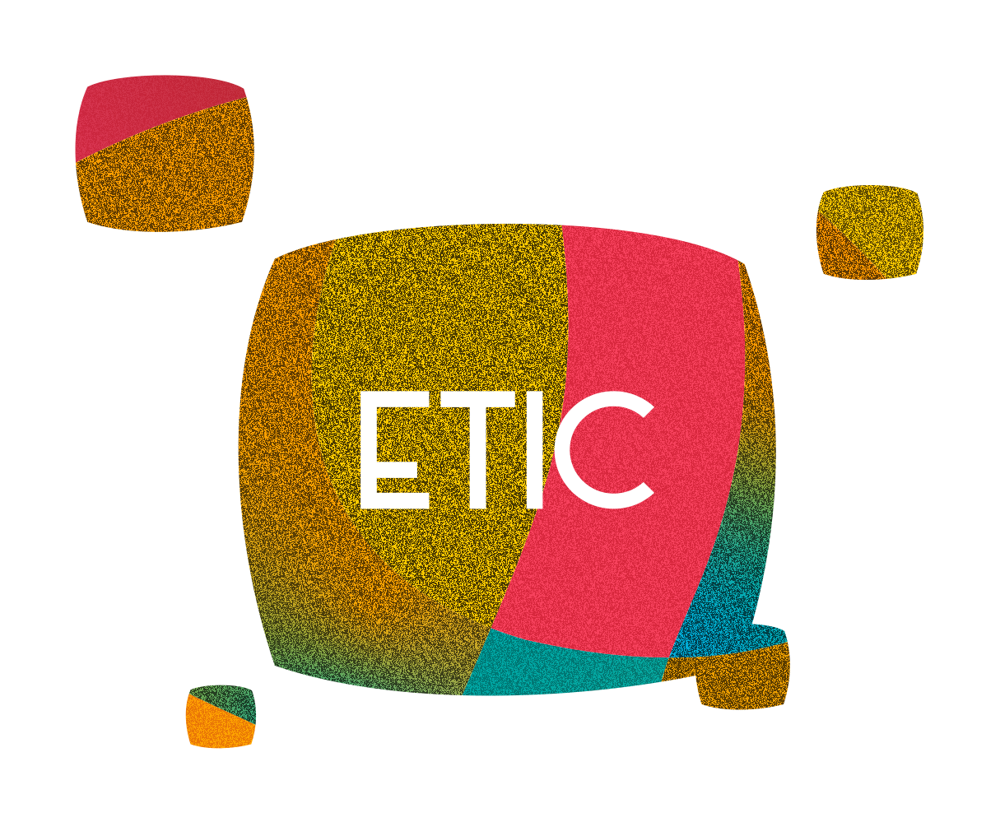

Sticker fini avec ses couleurs de création. Ne remplace pas le logo institutionnel.

- Fichier : [stickers/stickers-01.webp](../../etic-ui/assets/stickers/stickers-01.webp)
- Format : WEBP, 1215 × 999 px, 203.0 Ko
- [Source Figma 1:135](https://www.figma.com/design/eofQFq1bCM8Ooe5KXBDRsk?node-id=1-135)

## stickers-02

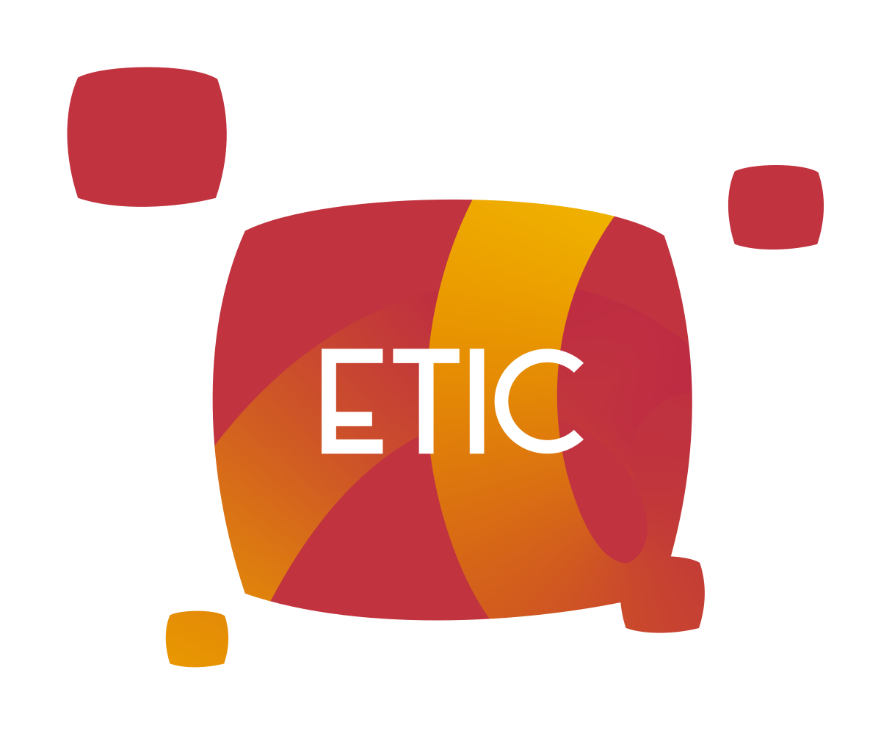

Sticker fini avec ses couleurs de création. Ne remplace pas le logo institutionnel.

- Fichier : [stickers/stickers-02.webp](../../etic-ui/assets/stickers/stickers-02.webp)
- Format : WEBP, 1215 × 999 px, 67.6 Ko
- [Source Figma 1:263](https://www.figma.com/design/eofQFq1bCM8Ooe5KXBDRsk?node-id=1-263)

## stickers-03

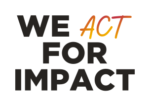

Sticker fini avec ses couleurs de création. Ne remplace pas le logo institutionnel.

- Fichier : [stickers/stickers-03.svg](../../etic-ui/assets/stickers/stickers-03.svg)
- Format : SVG, 304 × 216 px, 31.3 Ko
- [Source Figma 1:300](https://www.figma.com/design/eofQFq1bCM8Ooe5KXBDRsk?node-id=1-300)

## stickers-04

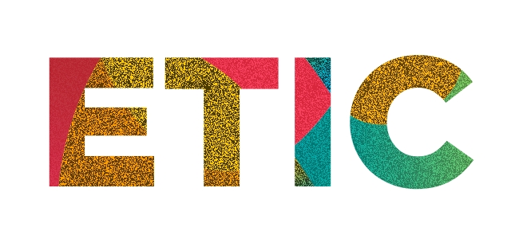

Sticker fini avec ses couleurs de création. Ne remplace pas le logo institutionnel.

- Fichier : [stickers/stickers-04.webp](../../etic-ui/assets/stickers/stickers-04.webp)
- Format : WEBP, 655 × 295 px, 37.6 Ko
- [Source Figma 1:318](https://www.figma.com/design/eofQFq1bCM8Ooe5KXBDRsk?node-id=1-318)

## stickers-05

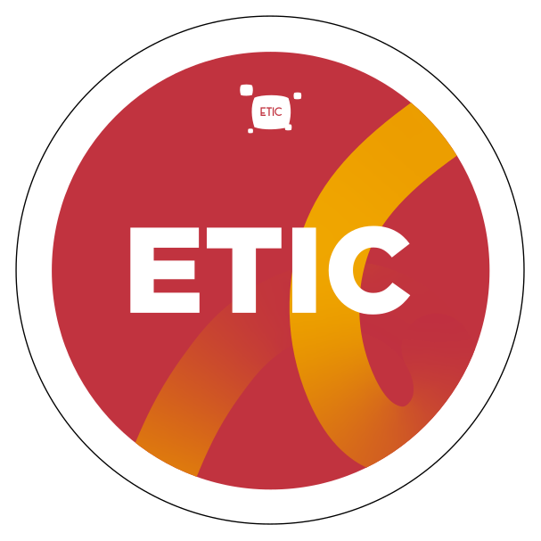

Sticker fini avec ses couleurs de création. Ne remplace pas le logo institutionnel.

- Fichier : [stickers/stickers-05.webp](../../etic-ui/assets/stickers/stickers-05.webp)
- Format : WEBP, 607 × 607 px, 32.8 Ko
- [Source Figma 1:435](https://www.figma.com/design/eofQFq1bCM8Ooe5KXBDRsk?node-id=1-435)

## stickers-06

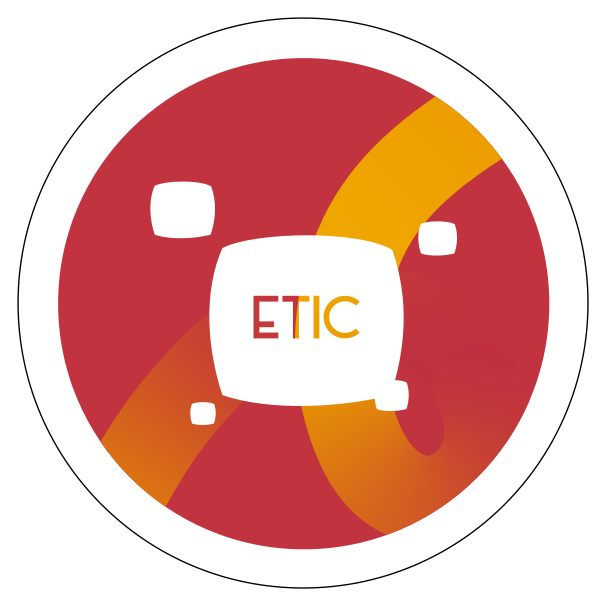

Sticker fini avec ses couleurs de création. Ne remplace pas le logo institutionnel.

- Fichier : [stickers/stickers-06.webp](../../etic-ui/assets/stickers/stickers-06.webp)
- Format : WEBP, 607 × 607 px, 32.2 Ko
- [Source Figma 1:478](https://www.figma.com/design/eofQFq1bCM8Ooe5KXBDRsk?node-id=1-478)

## stickers-07

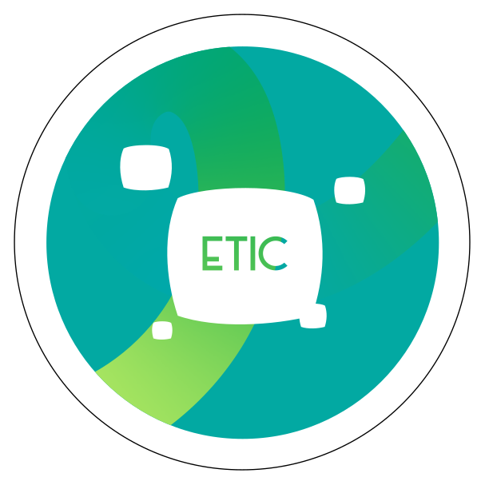

Sticker fini avec ses couleurs de création. Ne remplace pas le logo institutionnel.

- Fichier : [stickers/stickers-07.webp](../../etic-ui/assets/stickers/stickers-07.webp)
- Format : WEBP, 607 × 607 px, 37.4 Ko
- [Source Figma 1:516](https://www.figma.com/design/eofQFq1bCM8Ooe5KXBDRsk?node-id=1-516)

## stickers-08

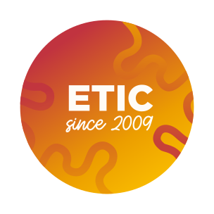

Sticker fini avec ses couleurs de création. Ne remplace pas le logo institutionnel.

- Fichier : [stickers/stickers-08.svg](../../etic-ui/assets/stickers/stickers-08.svg)
- Format : SVG, 304 × 304 px, 24.7 Ko
- [Source Figma 1:555](https://www.figma.com/design/eofQFq1bCM8Ooe5KXBDRsk?node-id=1-555)

## stickers-09

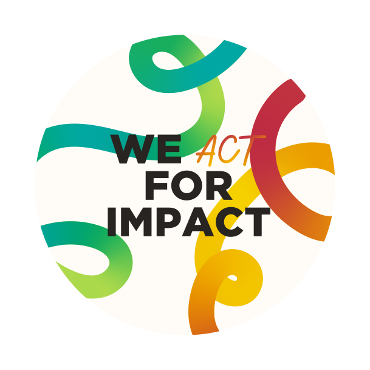

Sticker fini avec ses couleurs de création. Ne remplace pas le logo institutionnel.

**Association de composition (direction du projet, pas nouvelle règle officielle)**

Référence de la charte à consulter pour comprendre les formes.

À éviter : Contient des rubans chauds et froids : ne pas utiliser cette composition sur une page qui doit conserver une seule famille de rubans.

- Fichier : [stickers/stickers-09.webp](../../etic-ui/assets/stickers/stickers-09.webp)
- Format : WEBP, 609 × 609 px, 49.0 Ko
- [Source Figma 1:565](https://www.figma.com/design/eofQFq1bCM8Ooe5KXBDRsk?node-id=1-565)

## stickers-10

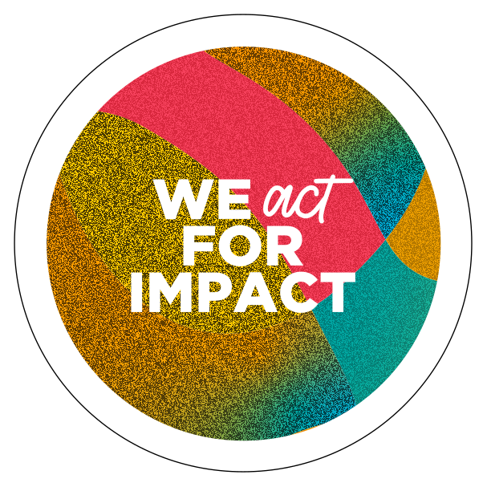

Sticker fini avec ses couleurs de création. Ne remplace pas le logo institutionnel.

- Fichier : [stickers/stickers-10.webp](../../etic-ui/assets/stickers/stickers-10.webp)
- Format : WEBP, 607 × 607 px, 130.7 Ko
- [Source Figma 1:682](https://www.figma.com/design/eofQFq1bCM8Ooe5KXBDRsk?node-id=1-682)

## stickers-11

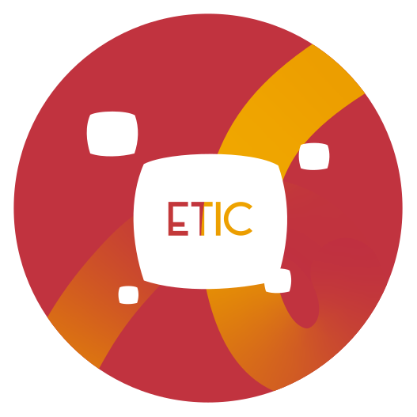

Sticker fini avec ses couleurs de création. Ne remplace pas le logo institutionnel.

- Fichier : [stickers/stickers-11.webp](../../etic-ui/assets/stickers/stickers-11.webp)
- Format : WEBP, 527 × 527 px, 24.8 Ko
- [Source Figma 1:833](https://www.figma.com/design/eofQFq1bCM8Ooe5KXBDRsk?node-id=1-833)

## stickers-12

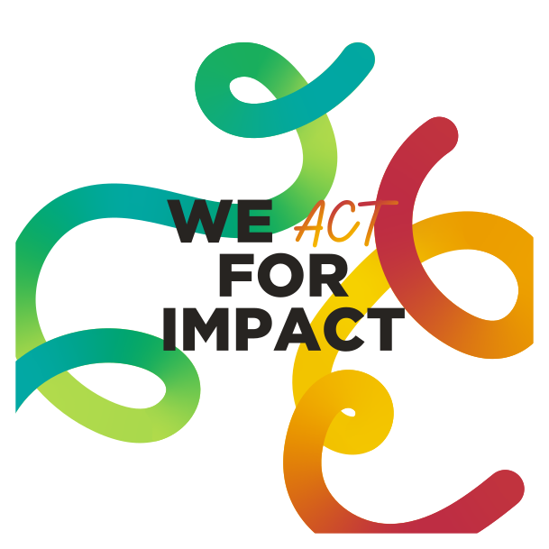

Sticker fini avec ses couleurs de création. Ne remplace pas le logo institutionnel.

**Association de composition (direction du projet, pas nouvelle règle officielle)**

Référence de la charte à consulter pour comprendre les formes.

À éviter : Contient des rubans chauds et froids : ne pas utiliser cette composition sur une page qui doit conserver une seule famille de rubans.

- Fichier : [stickers/stickers-12.webp](../../etic-ui/assets/stickers/stickers-12.webp)
- Format : WEBP, 609 × 609 px, 52.8 Ko
- [Source Figma 1:5812](https://www.figma.com/design/eofQFq1bCM8Ooe5KXBDRsk?node-id=1-5812)

## stickers-13

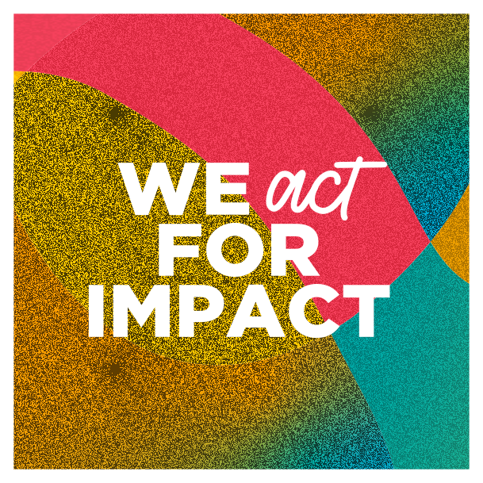

Sticker fini avec ses couleurs de création. Ne remplace pas le logo institutionnel.

- Fichier : [stickers/stickers-13.webp](../../etic-ui/assets/stickers/stickers-13.webp)
- Format : WEBP, 609 × 609 px, 183.2 Ko
- [Source Figma 1:5931](https://www.figma.com/design/eofQFq1bCM8Ooe5KXBDRsk?node-id=1-5931)
