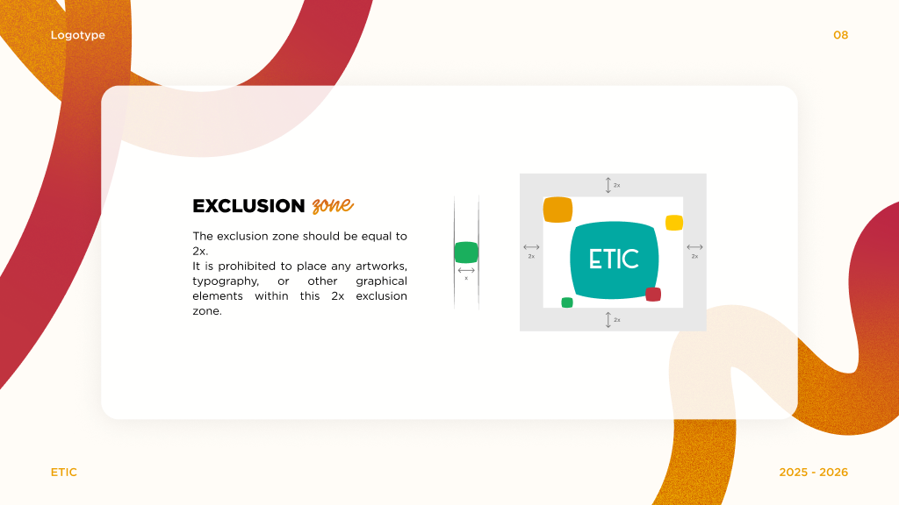

# Identité ETIC et choix d’interface

Source : [identité visuelle ETIC 2025–2026](https://www.figma.com/design/eofQFq1bCM8Ooe5KXBDRsk/ETIC-s-visual-ID?node-id=0-1), inspection MCP du 10 septembre 2026. Les nœuds ci-dessous permettent de retrouver chaque règle. Ce document distingue les prescriptions de la marque des adaptations techniques proposées.

## Palette officielle

[Planche 1:1460](https://www.figma.com/design/eofQFq1bCM8Ooe5KXBDRsk?node-id=1-1460).

| Groupe | Couleur | Valeur CSS |
| --- | --- | --- |
| Primaire | Teal | `--etic-teal: #02A9A2` |
| Primaire | Red | `--etic-red: #C1333F` |
| Primaire | Yellow | `--etic-yellow: #FFCA00` |
| Primaire | Orange | `--etic-orange: #EC9E00` |
| Primaire | Green | `--etic-green: #1AAF5D` |
| Secondaire | Ink | `--etic-ink: #272421` |
| Secondaire | Beige | `--etic-beige: #FFFCF7` |
| Additionnelle | Mint | `--etic-mint: #00DABF` |
| Additionnelle | Pink | `--etic-pink: #F6415C` |

Les noms de variables anglais sont des choix de code, pas des noms officiels relevés dans la charte.

## Dégradés officiels

[Planche 1:1534](https://www.figma.com/design/eofQFq1bCM8Ooe5KXBDRsk?node-id=1-1534). Les valeurs complètes, positions et matrices Figma sont conservées dans [figma-gradients.json](brand/figma-gradients.json).

| Dégradé | Nœud | Stops observés, arrondis en hex |
| --- | --- | --- |
| 1 | 1:1580 | Red à 16,8269 %, Orange à 65,8654 %, Yellow à 100 % |
| 2 | 1:1587 | Orange à 27,3326 %, `#E7BE6B` à 100 % |
| 3 | 1:1594 | Yellow à 0,0726 %, `#FFFAFA` à 100 % |
| 4 | 1:1601 | Teal à 19,2308 %, Mint à 74,0385 % |
| 5 | 1:1608 | Teal à 0 %, Green à 80,5699 % |

Le dégradé 1 contient un troisième stop jaune dans sa peinture, même si les légendes imprimées ne donnent que rouge et orange. Les directions CSS sont des **adaptations web**, pas une reproduction exacte des matrices sur toutes les tailles. Utiliser le SVG exporté pour un décor dont la géométrie et le dégradé doivent rester identiques. Les dégradés ne servent pas au texte courant.

## Combinaisons officielles

Planches [autorisées 1:1615](https://www.figma.com/design/eofQFq1bCM8Ooe5KXBDRsk?node-id=1-1615) et [interdites 1:1675](https://www.figma.com/design/eofQFq1bCM8Ooe5KXBDRsk?node-id=1-1675).

- Fonds de composition : rouge, dégradés 1, 2, 5 ou beige.
- Sur rouge : texte blanc, dégradé 1 ou dégradé 3.
- Sur dégradé 1 : texte blanc.
- Sur dégradé 2 : texte blanc, rouge ou dégradé 3.
- Sur beige : noir, dégradé 1, dégradé 5, rouge ou orange.
- Pas de nouvelles couleurs de fond de marque ; pas de texte qui se confond avec le fond ; éviter notamment jaune sur dégradé clair.

La règle écrite ne précise pas la couleur du texte sur dégradé 5. Ne pas inventer cette prescription. Certaines combinaisons illustrées ne garantissent pas un contraste suffisant pour du petit texte interactif. Le kit retient une sélection plus stricte pour les contrôles et conserve les autres possibilités pour la décoration, à vérifier selon le contexte.

## Sémantique UI proposée

| Token | Source | Usage |
| --- | --- | --- |
| surface | Beige officiel | Surface calme |
| text | Ink officiel | Texte principal |
| action / error | Red officiel | Action principale, erreur explicitement étiquetée |
| on-action | Blanc, autorisé sur rouge | Texte du bouton principal |
| success | `#146D40`, vert assombri proposé | Texte d’état lisible sur beige |
| muted | `#665D54`, neutre proposé | Texte secondaire lisible |
| border | `#B5AEA4`, neutre proposé | Séparation décorative, pas indicateur unique |
| focus | Ink officiel + halo beige | Focus visible sur surfaces claires ou rouges |

Ces trois couleurs dérivées ne deviennent pas des couleurs officielles. Elles ne sont pas proposées comme fonds de marque. Les états associent un libellé à leur couleur ; la réussite ne dépend jamais du vert seul.

Les espacements 4/8/12/16/24/32/48/64 px, rayons 8/16/24 px, tailles UI, ombre légère et transition de 160 ms sont également des choix applicatifs. La durée devient 0 ms lorsque l’utilisateur demande moins d’animations.

## Logos

Les deux emblèmes (couleur et blanc) proviennent des vecteurs existants, pas de tracés recréés. Les lettrages de titres et les stickers sont classés séparément. La charte interdit la déformation, le changement de couleur, l’ombre portée, la rotation, le retournement et la transformation en contour. Choisir un fond contrasté.

[Exclusion 1:3674](https://www.figma.com/design/eofQFq1bCM8Ooe5KXBDRsk?node-id=1-3674) : aucun texte ni décor dans une zone de **2×** autour du logo. Le repère x est le petit carré vert. Dans le logo de la planche (1:3717), sa largeur est 24,7566 pour un logo de 299, soit 2x ≈ 16,56 % de la largeur totale. `Logo` réserve 17 % par côté, arrondi prudent. Le repère isolé dessiné à côté est agrandi ; ne pas prendre sa largeur à l’écran comme valeur absolue.

Cette mesure est documentée pour l’emblème. Aucune mesure distincte pour les signatures horizontales n’a été vérifiée.

## Typographie

- [1:1808](https://www.figma.com/design/eofQFq1bCM8Ooe5KXBDRsk?node-id=1-1808) : Gotham, famille principale. Les calques utilisent notamment Gotham Pro et Gotham Black.
- [1:1880](https://www.figma.com/design/eofQFq1bCM8Ooe5KXBDRsk?node-id=1-1880) : Humming, famille secondaire expressive.
- [1:1900](https://www.figma.com/design/eofQFq1bCM8Ooe5KXBDRsk?node-id=1-1900) : Noto Sans Arabic.
- [1:1980](https://www.figma.com/design/eofQFq1bCM8Ooe5KXBDRsk?node-id=1-1980) : grands titres Gotham Black en capitales, petits titres Gotham Bold, sous-titres Humming, corps Gotham Regular.

Aucun binaire de police n’est inclus. Les fallbacks système sont fonctionnels mais ne reproduisent pas la typographie officielle. Ne pas prétendre à une fidélité typographique complète avant installation de fichiers autorisés. Voir [les informations polices](../etic-ui/assets/fonts/README.md).

## Décoration

Les planches 1:2082, 1:2391, 1:2458 et 1:2796 montrent rubans, lignes ondulées, formes et compositions géométriques, parfois avec texture de bruit. Les 33 planches sont archivées et les dix familles d’assets sont indexées dans [le catalogue](assets.md). Les omissions techniques et les doublons sont expliqués dans [la couverture](charter-coverage.md). Laisser une zone calme pour les actions, les textes importants et les logos.

Les surfaces blanches translucides des planches sont aussi des éléments officiels observés. Leurs propriétés sont disponibles séparément des tokens UI proposés : voir [les huit traitements de cartes](cards.md) et [les variantes de dégradés](gradients.md).

Pour composer un écran au-delà des tokens, lire [la direction artistique](art-direction.md), fondée sur les intentions écrites et les exemples de la charte.

La sélection d’une famille de rubans pour toute la page est une direction du propriétaire du projet, distincte de la palette officielle : [parcours de composition](composition-workflow.md).
