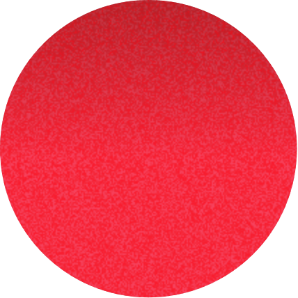
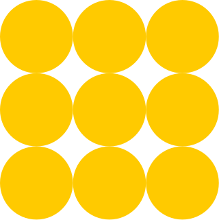
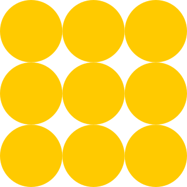
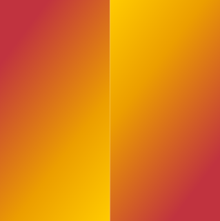
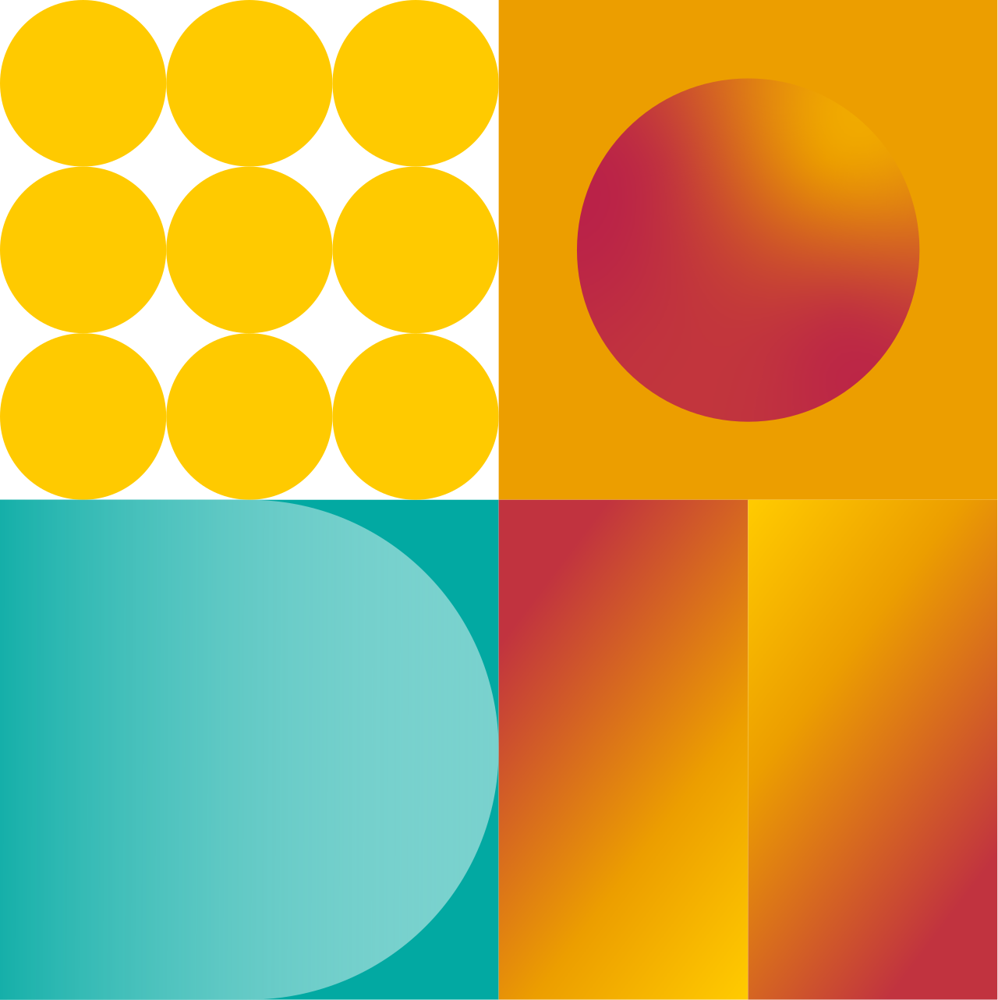

# Géométries ETIC

**Choisir le bon niveau de décomposition.** Une primitive est une forme seule ; un module conserve l’assemblage et la découpe d’origine ; une composition réunit plusieurs modules. Utiliser module-warm-square pour le carré central de la charte, et non double-disc-warm-free.

[Guide détaillé](../../../docs/geometry.md) · [Manifeste](../../asset-manifest.json)

## primitive

### disc-pink-texture

Primitive isolée. Son contour est conservé ; elle ne constitue pas à elle seule une composition complète.

[Fichier](primitives/disc-pink-texture.webp) · [Source 1:2810](https://www.figma.com/design/eofQFq1bCM8Ooe5KXBDRsk?node-id=1-2810)

### half-ellipse-mint

Primitive isolée. Son contour est conservé ; elle ne constitue pas à elle seule une composition complète.

[Fichier](primitives/half-ellipse-mint.svg) · [Source 1:2814](https://www.figma.com/design/eofQFq1bCM8Ooe5KXBDRsk?node-id=1-2814)

### half-disc-white

Primitive isolée. Son contour est conservé ; elle ne constitue pas à elle seule une composition complète.

[Fichier](primitives/half-disc-white.svg) · [Source 1:2815](https://www.figma.com/design/eofQFq1bCM8Ooe5KXBDRsk?node-id=1-2815)

### capsule-light-long

Primitive isolée. Son contour est conservé ; elle ne constitue pas à elle seule une composition complète.

[Fichier](primitives/capsule-light-long.svg) · [Source 1:2816](https://www.figma.com/design/eofQFq1bCM8Ooe5KXBDRsk?node-id=1-2816)

### disc-warm-texture

Primitive isolée. Son contour est conservé ; elle ne constitue pas à elle seule une composition complète.

[Fichier](primitives/disc-warm-texture.webp) · [Source 1:2832](https://www.figma.com/design/eofQFq1bCM8Ooe5KXBDRsk?node-id=1-2832)

### d-shape-teal

Primitive isolée. Son contour est conservé ; elle ne constitue pas à elle seule une composition complète.

[Fichier](primitives/d-shape-teal.svg) · [Source 1:2843](https://www.figma.com/design/eofQFq1bCM8Ooe5KXBDRsk?node-id=1-2843)

### gradient-block-01

Primitive isolée. Son contour est conservé ; elle ne constitue pas à elle seule une composition complète.

[Fichier](primitives/gradient-block-01.svg) · [Source 1:2846](https://www.figma.com/design/eofQFq1bCM8Ooe5KXBDRsk?node-id=1-2846)

### gradient-block-02

Primitive isolée. Son contour est conservé ; elle ne constitue pas à elle seule une composition complète.

[Fichier](primitives/gradient-block-02.svg) · [Source 1:2847](https://www.figma.com/design/eofQFq1bCM8Ooe5KXBDRsk?node-id=1-2847)

### bar-teal

Primitive isolée. Son contour est conservé ; elle ne constitue pas à elle seule une composition complète.

[Fichier](primitives/bar-teal.svg) · [Source 1:2807](https://www.figma.com/design/eofQFq1bCM8Ooe5KXBDRsk?node-id=1-2807)

### bar-orange

Primitive isolée. Son contour est conservé ; elle ne constitue pas à elle seule une composition complète.

[Fichier](primitives/bar-orange.svg) · [Source 1:2808](https://www.figma.com/design/eofQFq1bCM8Ooe5KXBDRsk?node-id=1-2808)

### bar-yellow

Primitive isolée. Son contour est conservé ; elle ne constitue pas à elle seule une composition complète.

[Fichier](primitives/bar-yellow.svg) · [Source 1:2809](https://www.figma.com/design/eofQFq1bCM8Ooe5KXBDRsk?node-id=1-2809)

### corner-cutout-teal-bottom

Contreforme teal à découpe concave, issue de la colonne source. Ne pas la confondre avec un quart de disque plein.

[Fichier](primitives/corner-cutout-teal-bottom.svg) · [Source 1:2811](https://www.figma.com/design/eofQFq1bCM8Ooe5KXBDRsk?node-id=1-2811)

### corner-cutout-teal-top

Contreforme teal à découpe concave, issue de la colonne source. Ne pas la confondre avec un quart de disque plein.

[Fichier](primitives/corner-cutout-teal-top.svg) · [Source 1:2812](https://www.figma.com/design/eofQFq1bCM8Ooe5KXBDRsk?node-id=1-2812)

### half-ellipse-teal

Primitive isolée. Son contour est conservé ; elle ne constitue pas à elle seule une composition complète.

[Fichier](primitives/half-ellipse-teal.svg) · [Source 1:2813](https://www.figma.com/design/eofQFq1bCM8Ooe5KXBDRsk?node-id=1-2813)

### dot-yellow

Primitive isolée. Son contour est conservé ; elle ne constitue pas à elle seule une composition complète.

[Fichier](primitives/dot-yellow.svg) · [Source 1:2823](https://www.figma.com/design/eofQFq1bCM8Ooe5KXBDRsk?node-id=1-2823)

### half-disc-warm-01

Demi-disque incliné avec le dégradé du nœud source. Pièce primitive du carré chaud ; utiliser module-warm-square pour retrouver son cadrage original.

[Fichier](primitives/half-disc-warm-01.svg) · [Source 1:2850](https://www.figma.com/design/eofQFq1bCM8Ooe5KXBDRsk?node-id=1-2850)

### half-disc-warm-02

Demi-disque incliné avec le dégradé du nœud source. Pièce primitive du carré chaud ; utiliser module-warm-square pour retrouver son cadrage original.

[Fichier](primitives/half-disc-warm-02.svg) · [Source 1:2851](https://www.figma.com/design/eofQFq1bCM8Ooe5KXBDRsk?node-id=1-2851)

### half-disc-warm-03

Demi-disque incliné avec le dégradé du nœud source. Pièce primitive du carré chaud ; utiliser module-warm-square pour retrouver son cadrage original.

[Fichier](primitives/half-disc-warm-03.svg) · [Source 1:2852](https://www.figma.com/design/eofQFq1bCM8Ooe5KXBDRsk?node-id=1-2852)

### half-disc-warm-04

Demi-disque incliné avec le dégradé du nœud source. Pièce primitive du carré chaud ; utiliser module-warm-square pour retrouver son cadrage original.

[Fichier](primitives/half-disc-warm-04.svg) · [Source 1:2853](https://www.figma.com/design/eofQFq1bCM8Ooe5KXBDRsk?node-id=1-2853)

## module

### dots-nine

Module composé et recadré selon la planche source. Conserver le cadrage, les proportions et les rapports entre ses parties.

[Fichier](modules/dots-nine.svg) · [Source 1:2821](https://www.figma.com/design/eofQFq1bCM8Ooe5KXBDRsk?node-id=1-2821)

### module-warm-square

Module composé et recadré selon la planche source. Conserver le cadrage, les proportions et les rapports entre ses parties.

[Fichier](modules/module-warm-square.svg) · [Source 1:2848](https://www.figma.com/design/eofQFq1bCM8Ooe5KXBDRsk?node-id=1-2848)

### module-dots

Module composé et recadré selon la planche source. Conserver le cadrage, les proportions et les rapports entre ses parties.

[Fichier](modules/module-dots.svg) · [Source 1:2817](https://www.figma.com/design/eofQFq1bCM8Ooe5KXBDRsk?node-id=1-2817)

### module-disc-orange

Module composé et recadré selon la planche source. Conserver le cadrage, les proportions et les rapports entre ses parties.

[Fichier](modules/module-disc-orange.webp) · [Source 1:2817](https://www.figma.com/design/eofQFq1bCM8Ooe5KXBDRsk?node-id=1-2817)

### module-d-teal

Module composé et recadré selon la planche source. Conserver le cadrage, les proportions et les rapports entre ses parties.

[Fichier](modules/module-d-teal.svg) · [Source 1:2817](https://www.figma.com/design/eofQFq1bCM8Ooe5KXBDRsk?node-id=1-2817)

### module-stripes-warm

Module composé et recadré selon la planche source. Conserver le cadrage, les proportions et les rapports entre ses parties.

[Fichier](modules/module-stripes-warm.svg) · [Source 1:2817](https://www.figma.com/design/eofQFq1bCM8Ooe5KXBDRsk?node-id=1-2817)

### module-teal-column

Module composé et recadré selon la planche source. Conserver le cadrage, les proportions et les rapports entre ses parties.

[Fichier](modules/module-teal-column.svg) · [Source 1:2804](https://www.figma.com/design/eofQFq1bCM8Ooe5KXBDRsk?node-id=1-2804)

### module-orange-column

Module composé et recadré selon la planche source. Conserver le cadrage, les proportions et les rapports entre ses parties.

[Fichier](modules/module-orange-column.webp) · [Source 1:2804](https://www.figma.com/design/eofQFq1bCM8Ooe5KXBDRsk?node-id=1-2804)

### module-yellow-column

Module composé et recadré selon la planche source. Conserver le cadrage, les proportions et les rapports entre ses parties.

[Fichier](modules/module-yellow-column.svg) · [Source 1:2804](https://www.figma.com/design/eofQFq1bCM8Ooe5KXBDRsk?node-id=1-2804)

## composition

### geometric-columns

Composition complète. Les éléments qui la constituent sont également disponibles comme primitives ou modules.

[Fichier](compositions/geometric-columns.webp) · [Source 1:2804](https://www.figma.com/design/eofQFq1bCM8Ooe5KXBDRsk?node-id=1-2804)

### double-disc-warm-free

Paire de disques inclinés, extraite sans le recadrage du frame. Pour retrouver le carré de la planche, choisir module-warm-square.

[Fichier](compositions/double-disc-warm-free.svg) · [Source 1:2849](https://www.figma.com/design/eofQFq1bCM8Ooe5KXBDRsk?node-id=1-2849)

### geometric-pattern

Composition complète. Les éléments qui la constituent sont également disponibles comme primitives ou modules.

[Fichier](compositions/geometric-pattern.webp) · [Source 1:2817](https://www.figma.com/design/eofQFq1bCM8Ooe5KXBDRsk?node-id=1-2817)
