# Rubans ETIC

**Une seule famille de rubans colorés par page : warm OU cool.** neutral désigne le trait noir. Les vagues, slogans et grands rubans sont aussi rangés ici. Aucune recoloration artificielle n’est proposée pour fabriquer des variantes absentes de Figma.

[Guide détaillé](../../../docs/composition-workflow.md) · [Manifeste](../../asset-manifest.json)

## warm

### ribbon-warm-arc-01

Ruban isolé. Réserver une marge ou une zone de décoration.

[Fichier](warm/ribbon-warm-arc-01.webp) · [Source 1:2234](https://www.figma.com/design/eofQFq1bCM8Ooe5KXBDRsk?node-id=1-2234)

### ribbon-warm-loop-01

Ruban isolé. Réserver une marge ou une zone de décoration.

[Fichier](warm/ribbon-warm-loop-01.webp) · [Source 1:2253](https://www.figma.com/design/eofQFq1bCM8Ooe5KXBDRsk?node-id=1-2253)

### ribbon-warm-arc-02

Ruban isolé. Réserver une marge ou une zone de décoration.

[Fichier](warm/ribbon-warm-arc-02.webp) · [Source 1:2282](https://www.figma.com/design/eofQFq1bCM8Ooe5KXBDRsk?node-id=1-2282)

### ribbon-warm-twist

Ruban isolé. Réserver une marge ou une zone de décoration.

[Fichier](warm/ribbon-warm-twist.webp) · [Source 1:2302](https://www.figma.com/design/eofQFq1bCM8Ooe5KXBDRsk?node-id=1-2302)

### ribbon-warm-arc-03

Ruban isolé. Réserver une marge ou une zone de décoration.

[Fichier](warm/ribbon-warm-arc-03.webp) · [Source 1:2331](https://www.figma.com/design/eofQFq1bCM8Ooe5KXBDRsk?node-id=1-2331)

### ribbon-warm-loop-02

Ruban isolé. Réserver une marge ou une zone de décoration.

[Fichier](warm/ribbon-warm-loop-02.webp) · [Source 1:2351](https://www.figma.com/design/eofQFq1bCM8Ooe5KXBDRsk?node-id=1-2351)

### ribbon-warm-wave

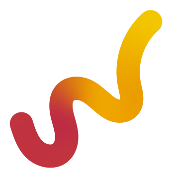

Ruban isolé. Réserver une marge ou une zone de décoration.

[Fichier](warm/ribbon-warm-wave.webp) · [Source 1:2380](https://www.figma.com/design/eofQFq1bCM8Ooe5KXBDRsk?node-id=1-2380)

### wave-impact

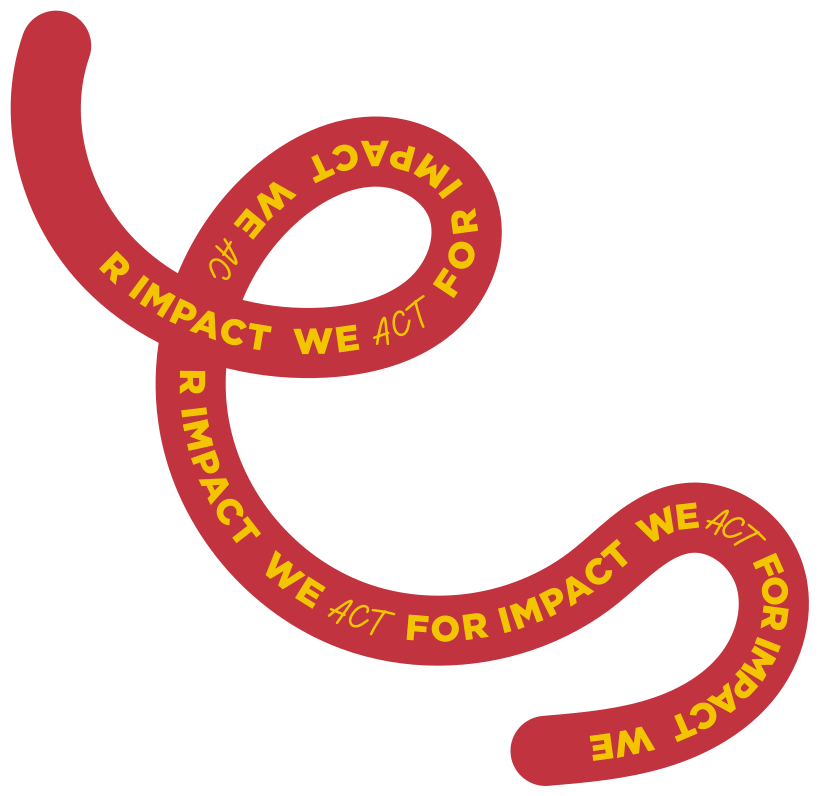

Courbe isolée. Éviter les contrôles et les textes.

[Fichier](warm/wave-impact.svg) · [Source 1:2459](https://www.figma.com/design/eofQFq1bCM8Ooe5KXBDRsk?node-id=1-2459)

### wave-warm-long

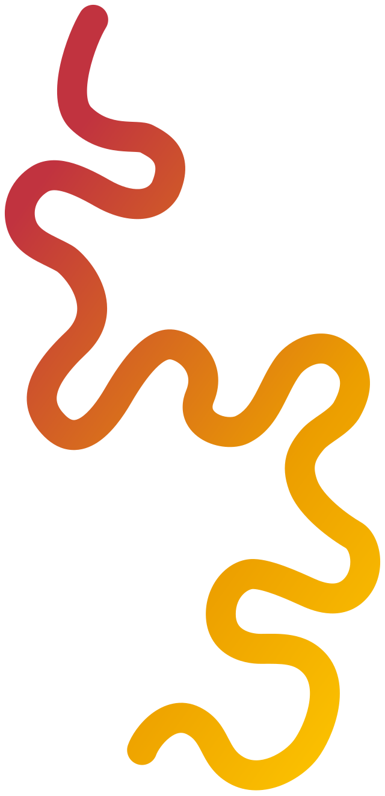

Courbe isolée. Éviter les contrôles et les textes.

[Fichier](warm/wave-warm-long.svg) · [Source 1:2531](https://www.figma.com/design/eofQFq1bCM8Ooe5KXBDRsk?node-id=1-2531)

### wave-light-short

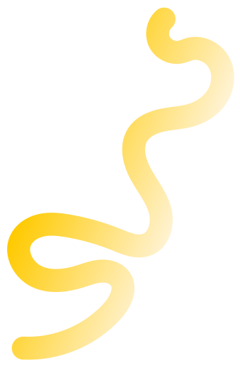

Courbe isolée. Éviter les contrôles et les textes.

[Fichier](warm/wave-light-short.svg) · [Source 1:2532](https://www.figma.com/design/eofQFq1bCM8Ooe5KXBDRsk?node-id=1-2532)

### wave-dream-team

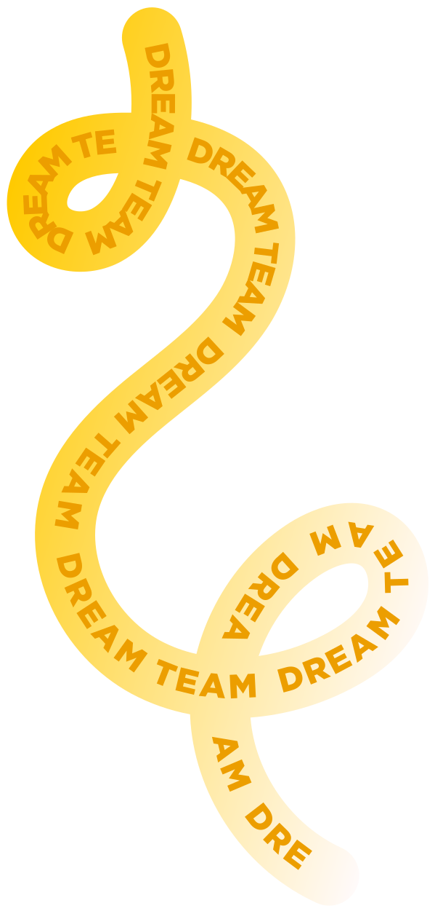

Courbe isolée. Éviter les contrôles et les textes.

[Fichier](warm/wave-dream-team.svg) · [Source 1:2535](https://www.figma.com/design/eofQFq1bCM8Ooe5KXBDRsk?node-id=1-2535)

### wave-light-long

Courbe isolée. Éviter les contrôles et les textes.

[Fichier](warm/wave-light-long.svg) · [Source 1:2599](https://www.figma.com/design/eofQFq1bCM8Ooe5KXBDRsk?node-id=1-2599)

### wave-entrepreneurship

Courbe isolée. Éviter les contrôles et les textes.

[Fichier](warm/wave-entrepreneurship.svg) · [Source 1:2602](https://www.figma.com/design/eofQFq1bCM8Ooe5KXBDRsk?node-id=1-2602)

### wave-pattern-01

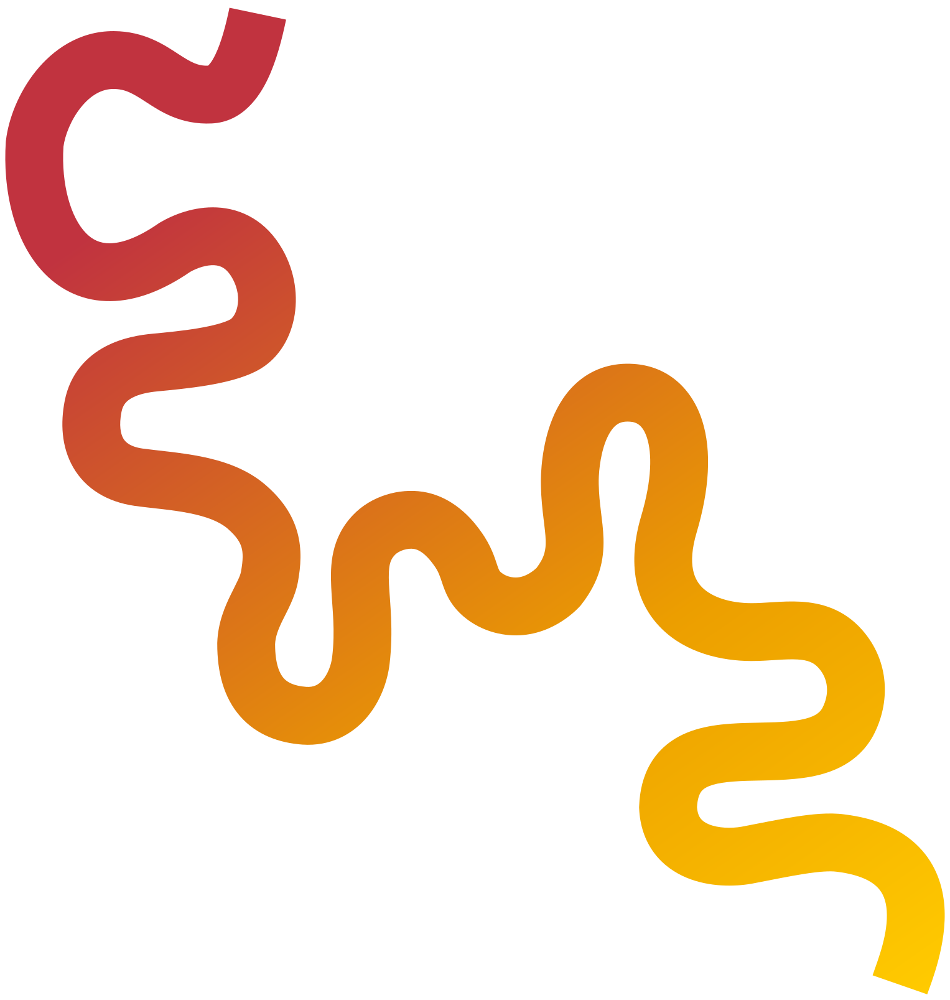

Courbe isolée. Éviter les contrôles et les textes.

[Fichier](warm/wave-pattern-01.svg) · [Source 1:2857](https://www.figma.com/design/eofQFq1bCM8Ooe5KXBDRsk?node-id=1-2857)

### wave-pattern-02

Courbe isolée. Éviter les contrôles et les textes.

[Fichier](warm/wave-pattern-02.svg) · [Source 1:2861](https://www.figma.com/design/eofQFq1bCM8Ooe5KXBDRsk?node-id=1-2861)

### wave-pattern-03

Courbe isolée. Éviter les contrôles et les textes.

[Fichier](warm/wave-pattern-03.svg) · [Source 1:2872](https://www.figma.com/design/eofQFq1bCM8Ooe5KXBDRsk?node-id=1-2872)

### wave-pattern-04

Courbe isolée. Éviter les contrôles et les textes.

[Fichier](warm/wave-pattern-04.svg) · [Source 1:2873](https://www.figma.com/design/eofQFq1bCM8Ooe5KXBDRsk?node-id=1-2873)

### wave-pattern-05

Courbe isolée. Éviter les contrôles et les textes.

[Fichier](warm/wave-pattern-05.svg) · [Source 1:2874](https://www.figma.com/design/eofQFq1bCM8Ooe5KXBDRsk?node-id=1-2874)

### loop-palette-warm

Composition existante. Conserver le rapport entre ses éléments.

[Fichier](warm/loop-palette-warm.webp) · [Source 1:2409](https://www.figma.com/design/eofQFq1bCM8Ooe5KXBDRsk?node-id=1-2409)

### ribbon-warm-oversized

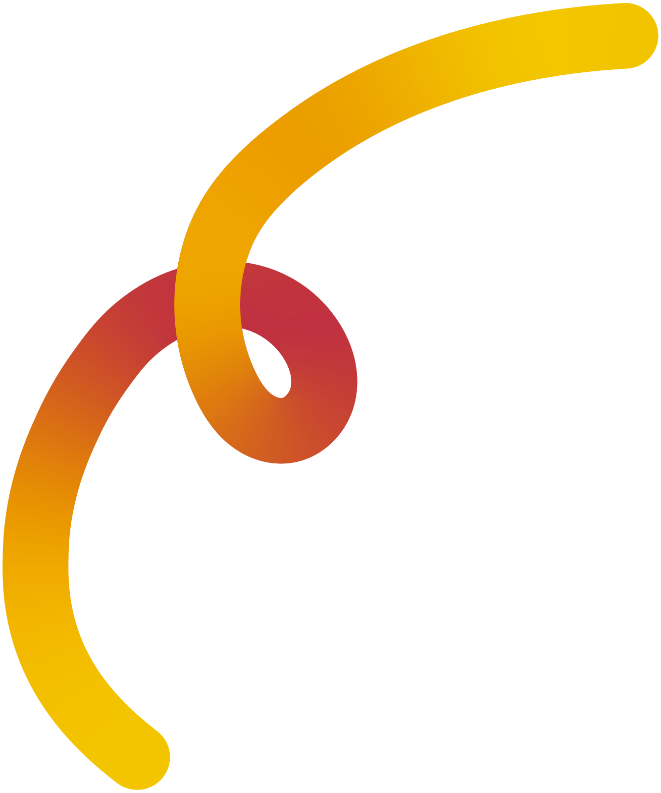

Composition existante. Conserver le rapport entre ses éléments.

[Fichier](warm/ribbon-warm-oversized.webp) · [Source 1:874](https://www.figma.com/design/eofQFq1bCM8Ooe5KXBDRsk?node-id=1-874)

### ribbon-stationery

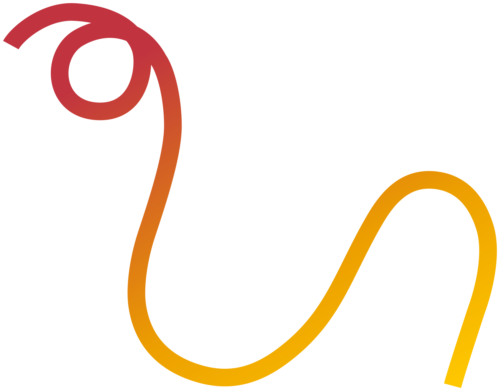

Composition existante. Conserver le rapport entre ses éléments.

[Fichier](warm/ribbon-stationery.svg) · [Source 1:3500](https://www.figma.com/design/eofQFq1bCM8Ooe5KXBDRsk?node-id=1-3500)

### wave-warm

Courbe isolée. Éviter les contrôles et les textes.

[Fichier](warm/wave-warm.svg) · [Source 1:2662](https://www.figma.com/design/eofQFq1bCM8Ooe5KXBDRsk?node-id=1-2662)

### ribbon-story-warm

Élément isolé de la composition source. Conserver ses proportions et réserver une zone décorative.

[Fichier](warm/ribbon-story-warm.webp) · [Source 1:3281](https://www.figma.com/design/eofQFq1bCM8Ooe5KXBDRsk?node-id=1-3281)

### wave-story-slogan

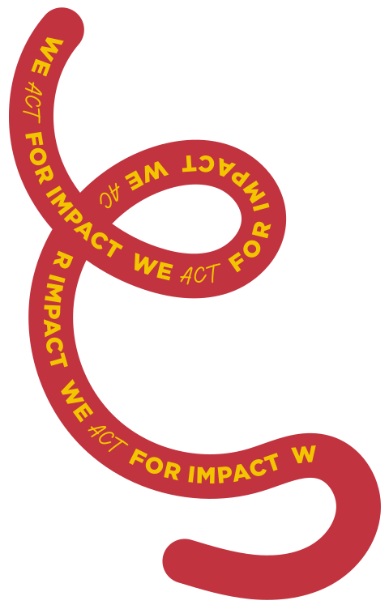

Élément isolé de la composition source. Conserver ses proportions et réserver une zone décorative.

[Fichier](warm/wave-story-slogan.svg) · [Source 1:3367](https://www.figma.com/design/eofQFq1bCM8Ooe5KXBDRsk?node-id=1-3367)

### ribbon-banner-loop

Ruban chaud exporté de son contexte source, sans fond de page. Choisir la même famille de rubans sur toute la page.

[Fichier](warm/ribbon-banner-loop.webp) · [Source 1:36](https://www.figma.com/design/eofQFq1bCM8Ooe5KXBDRsk?node-id=1-36)

### ribbon-banner-arc

Ruban chaud exporté de son contexte source, sans fond de page. Choisir la même famille de rubans sur toute la page.

[Fichier](warm/ribbon-banner-arc.webp) · [Source 1:56](https://www.figma.com/design/eofQFq1bCM8Ooe5KXBDRsk?node-id=1-56)

### ribbon-contents-loop

Ruban chaud exporté de son contexte source, sans fond de page. Choisir la même famille de rubans sur toute la page.

[Fichier](warm/ribbon-contents-loop.webp) · [Source 1:945](https://www.figma.com/design/eofQFq1bCM8Ooe5KXBDRsk?node-id=1-945)

### ribbon-clearspace-loop

Ruban chaud exporté de son contexte source, sans fond de page. Choisir la même famille de rubans sur toute la page.

[Fichier](warm/ribbon-clearspace-loop.webp) · [Source 1:3675](https://www.figma.com/design/eofQFq1bCM8Ooe5KXBDRsk?node-id=1-3675)

### ribbon-clearspace-crossing

Ruban chaud exporté de son contexte source, sans fond de page. Choisir la même famille de rubans sur toute la page.

[Fichier](warm/ribbon-clearspace-crossing.webp) · [Source 1:3686](https://www.figma.com/design/eofQFq1bCM8Ooe5KXBDRsk?node-id=1-3686)

### ribbon-card-front

Ruban chaud exporté de son contexte source, sans fond de page. Choisir la même famille de rubans sur toute la page.

[Fichier](warm/ribbon-card-front.webp) · [Source 1:3509](https://www.figma.com/design/eofQFq1bCM8Ooe5KXBDRsk?node-id=1-3509)

### ribbon-card-back

Ruban chaud exporté de son contexte source, sans fond de page. Choisir la même famille de rubans sur toute la page.

[Fichier](warm/ribbon-card-back.webp) · [Source 1:3546](https://www.figma.com/design/eofQFq1bCM8Ooe5KXBDRsk?node-id=1-3546)

## cool

### ribbon-cool-loop-01

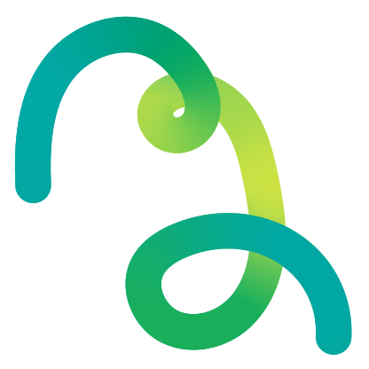

Ruban isolé. Réserver une marge ou une zone de décoration.

[Fichier](cool/ribbon-cool-loop-01.webp) · [Source 1:2094](https://www.figma.com/design/eofQFq1bCM8Ooe5KXBDRsk?node-id=1-2094)

### ribbon-cool-loop-02

Ruban isolé. Réserver une marge ou une zone de décoration.

[Fichier](cool/ribbon-cool-loop-02.webp) · [Source 1:2123](https://www.figma.com/design/eofQFq1bCM8Ooe5KXBDRsk?node-id=1-2123)

### ribbon-cool-loop-03

Ruban isolé. Réserver une marge ou une zone de décoration.

[Fichier](cool/ribbon-cool-loop-03.webp) · [Source 1:2152](https://www.figma.com/design/eofQFq1bCM8Ooe5KXBDRsk?node-id=1-2152)

### ribbon-cool-wave

Ruban isolé. Réserver une marge ou une zone de décoration.

[Fichier](cool/ribbon-cool-wave.webp) · [Source 1:2172](https://www.figma.com/design/eofQFq1bCM8Ooe5KXBDRsk?node-id=1-2172)

### ribbon-cool-arc

Ruban isolé. Réserver une marge ou une zone de décoration.

[Fichier](cool/ribbon-cool-arc.webp) · [Source 1:2183](https://www.figma.com/design/eofQFq1bCM8Ooe5KXBDRsk?node-id=1-2183)

### ribbon-cool-twist

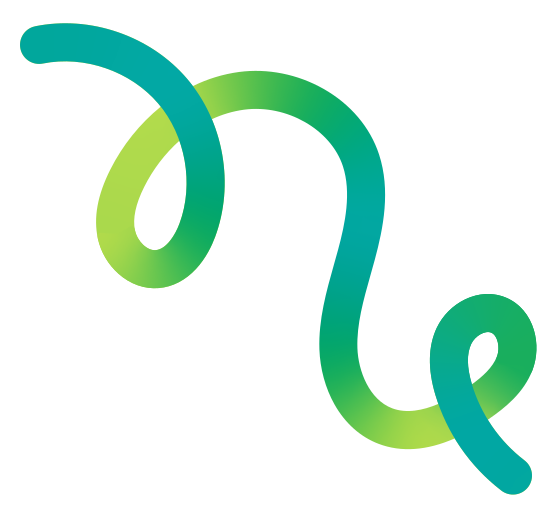

Ruban isolé. Réserver une marge ou une zone de décoration.

[Fichier](cool/ribbon-cool-twist.webp) · [Source 1:2203](https://www.figma.com/design/eofQFq1bCM8Ooe5KXBDRsk?node-id=1-2203)

### loop-palette-cool

Composition existante. Conserver le rapport entre ses éléments.

[Fichier](cool/loop-palette-cool.webp) · [Source 1:2433](https://www.figma.com/design/eofQFq1bCM8Ooe5KXBDRsk?node-id=1-2433)

### ribbon-cool-crossing

Composition existante. Conserver le rapport entre ses éléments.

[Fichier](cool/ribbon-cool-crossing.webp) · [Source 1:1276](https://www.figma.com/design/eofQFq1bCM8Ooe5KXBDRsk?node-id=1-1276)

### ribbon-cool-tall

Composition existante. Conserver le rapport entre ses éléments.

[Fichier](cool/ribbon-cool-tall.webp) · [Source 1:1461](https://www.figma.com/design/eofQFq1bCM8Ooe5KXBDRsk?node-id=1-1461)

## neutral

### loop-thin-ink

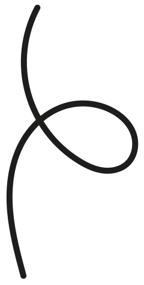

Élément isolé de la composition source. Conserver ses proportions et réserver une zone décorative.

[Fichier](neutral/loop-thin-ink.svg) · [Source 1:2400](https://www.figma.com/design/eofQFq1bCM8Ooe5KXBDRsk?node-id=1-2400)
